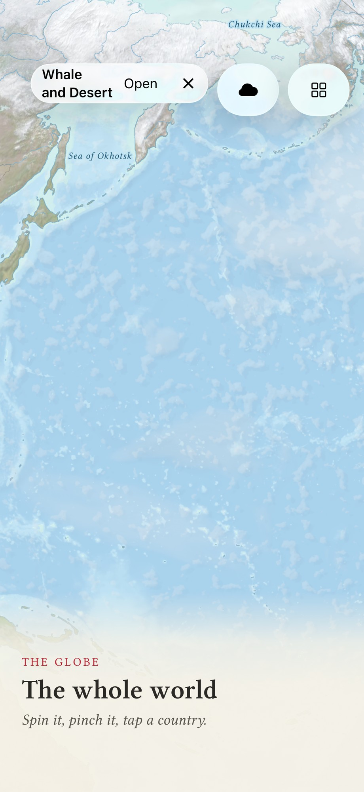
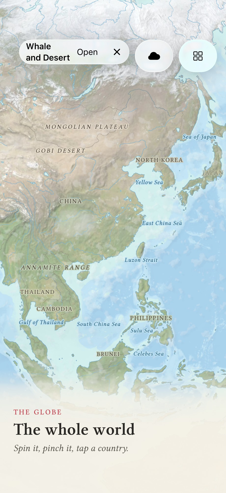
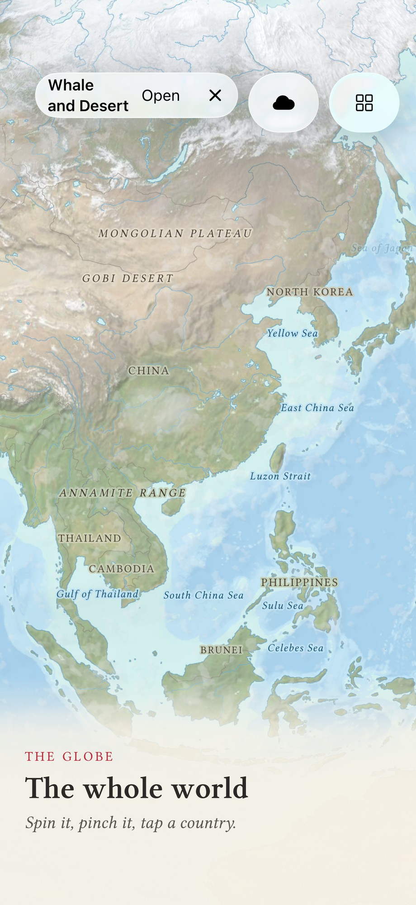

# Agent transcript

- end: error_during_execution, 59 turns, 14.7 min, estimated $1.1020513999999997
- tool calls: {"mcp__maestro__take_screenshot": 10, "mcp__maestro__inspect_screen": 13, "Read": 9, "mcp__maestro__run": 16, "Write": 2}
- images the agent received: 17

**Start**: model claude-opus-5-5, MCP [{"name": "maestro", "status": "connected", "source": "dynamic"}]

→ `mcp__maestro__take_screenshot` `{"device_id": "E839A11B-51B4-4AD3-ACF4-A53B95B7C957"}`

→ `mcp__maestro__inspect_screen` `{"device_id": "E839A11B-51B4-4AD3-ACF4-A53B95B7C957"}`

← mcp__maestro__take_screenshot: image  919x2000

← mcp__maestro__inspect_screen: {"ui_schema":{"platform":"ios","abbreviations":{"b":"bounds","txt":"text","rid":"resource-id","a11y":"accessibilityText","hint":"hintText","val":"value","c":"children"},"defaults":{"enabled":true,"focused":false,"selected":false,"checked":false,"txt":"","hint":"","rid":"","val":"","a11y":""}},"elements":[{"b":"[0,0][402,874]","a11y":"Terra Incognita","c":[{"b":"[0,0][402,874]","c":[{"b":"[0,0][402 …

→ `Read` `{"file_path": "/Users/runner/work/_temp/qa/app.log"}`

← Read: 1	getpwuid_r did not find a match for uid 501
2	Filtering the log data using "subsystem == "com.pbordjadze.terraincognita""
3	Timestamp               Ty Process[PID:TID]
4	2026-10-28 07:27:29.097 I  TerraIncognita[10670:93ae] [com.pbordjadze.terraincognita:playground] clouds: 0.2 ms of GPU a frame, at 2.00 pixels a point
5	2026-10-28 07:27:39.129 I  TerraIncognita[10670:93ae] [com.pbordjadze.terra …

→ `mcp__maestro__run` `{"device_id": "E839A11B-51B4-4AD3-ACF4-A53B95B7C957", "yaml": "appId: com.pbordjadze.terraincognita\n---\n- takeScreenshot: /Users/runner/work/_temp/qa/shots/01-start"}`

→ `mcp__maestro__inspect_screen` `{"device_id": "E839A11B-51B4-4AD3-ACF4-A53B95B7C957"}`

← mcp__maestro__run: {"success":true,"device_id":"E839A11B-51B4-4AD3-ACF4-A53B95B7C957","commands_executed":2,"message":"Flow executed successfully","env_vars":{"MAESTRO_CLI_ANALYSIS_NOTIFICATION_DISABLED":"true","MAESTRO_CLI_NO_ANALYTICS":"1","MAESTRO_DRIVER_STARTUP_TIMEOUT":"240000","MAESTRO_VERSION":"2.11.0"}}

← mcp__maestro__inspect_screen: {"ui_schema":{"platform":"ios","abbreviations":{"b":"bounds","txt":"text","rid":"resource-id","a11y":"accessibilityText","hint":"hintText","val":"value","c":"children"},"defaults":{"enabled":true,"focused":false,"selected":false,"checked":false,"txt":"","hint":"","rid":"","val":"","a11y":""}},"elements":[{"b":"[0,0][402,874]","a11y":"Terra Incognita","c":[{"b":"[0,0][402,874]","c":[{"b":"[0,0][402 …

→ `Read` `{"file_path": "/Users/runner/work/_temp/qa/shots/01-start.png"}`

← Read: image  920x2000

→ `mcp__maestro__run` `{"device_id": "E839A11B-51B4-4AD3-ACF4-A53B95B7C957", "yaml": "appId: com.pbordjadze.terraincognita\n---\n- tapOn:\n    id: \"doorway.gathering-of-water\"\n- takeScreenshot: /Users/runner/work/_temp/qa/shots/02-tap-hidden-doorway"}`

→ `mcp__maestro__inspect_screen` `{"device_id": "E839A11B-51B4-4AD3-ACF4-A53B95B7C957"}`

← mcp__maestro__run: {"success":true,"device_id":"E839A11B-51B4-4AD3-ACF4-A53B95B7C957","commands_executed":3,"message":"Flow executed successfully","env_vars":{"MAESTRO_CLI_ANALYSIS_NOTIFICATION_DISABLED":"true","MAESTRO_CLI_NO_ANALYTICS":"1","MAESTRO_DRIVER_STARTUP_TIMEOUT":"240000","MAESTRO_VERSION":"2.11.0"}}

← mcp__maestro__inspect_screen: {"ui_schema":{"platform":"ios","abbreviations":{"b":"bounds","txt":"text","rid":"resource-id","a11y":"accessibilityText","hint":"hintText","val":"value","c":"children"},"defaults":{"enabled":true,"focused":false,"selected":false,"checked":false,"txt":"","hint":"","rid":"","val":"","a11y":""}},"elements":[{"b":"[0,0][402,874]","a11y":"Terra Incognita","c":[{"b":"[0,0][402,874]","c":[{"b":"[0,0][402 …

→ `Read` `{"file_path": "/Users/runner/work/_temp/qa/shots/02-tap-hidden-doorway.png"}`

← Read: image  920x2000

→ `mcp__maestro__run` `{"device_id": "E839A11B-51B4-4AD3-ACF4-A53B95B7C957", "yaml": "appId: com.pbordjadze.terraincognita\n---\n- tapOn:\n    id: \"doorway.sounding-the-deep\"\n- takeScreenshot: /Users/runner/work/_temp/qa/shots/03-sounding"}`

→ `mcp__maestro__inspect_screen` `{"device_id": "E839A11B-51B4-4AD3-ACF4-A53B95B7C957"}`

← mcp__maestro__run: {"success":true,"device_id":"E839A11B-51B4-4AD3-ACF4-A53B95B7C957","commands_executed":3,"message":"Flow executed successfully","env_vars":{"MAESTRO_CLI_ANALYSIS_NOTIFICATION_DISABLED":"true","MAESTRO_CLI_NO_ANALYTICS":"1","MAESTRO_DRIVER_STARTUP_TIMEOUT":"240000","MAESTRO_VERSION":"2.11.0"}}

← mcp__maestro__inspect_screen: {"ui_schema":{"platform":"ios","abbreviations":{"b":"bounds","txt":"text","rid":"resource-id","a11y":"accessibilityText","hint":"hintText","val":"value","c":"children"},"defaults":{"enabled":true,"focused":false,"selected":false,"checked":false,"txt":"","hint":"","rid":"","val":"","a11y":""}},"elements":[{"b":"[0,0][402,874]","a11y":"Terra Incognita","c":[{"b":"[0,0][402,874]","c":[{"b":"[0,0][402 …

→ `Read` `{"file_path": "/Users/runner/work/_temp/qa/shots/03-sounding.png"}`

← Read: image  920x2000

→ `mcp__maestro__take_screenshot` `{"device_id": "E839A11B-51B4-4AD3-ACF4-A53B95B7C957"}`

← mcp__maestro__take_screenshot: image  919x2000

→ `mcp__maestro__inspect_screen` `{"device_id": "E839A11B-51B4-4AD3-ACF4-A53B95B7C957"}`

← mcp__maestro__inspect_screen: {"ui_schema":{"platform":"ios","abbreviations":{"b":"bounds","txt":"text","rid":"resource-id","a11y":"accessibilityText","hint":"hintText","val":"value","c":"children"},"defaults":{"enabled":true,"focused":false,"selected":false,"checked":false,"txt":"","hint":"","rid":"","val":"","a11y":""}},"elements":[{"b":"[0,0][402,874]","a11y":"Terra Incognita","c":[{"b":"[0,0][402,874]","c":[{"b":"[0,0][402 …

> Sounding the deep started from its ship doorway. Now I'll try Open.

→ `mcp__maestro__run` `{"device_id": "E839A11B-51B4-4AD3-ACF4-A53B95B7C957", "yaml": "appId: com.pbordjadze.terraincognita\n---\n- tapOn:\n    id: \"openActivePrototype\"\n- waitForAnimationToEnd\n- takeScreenshot: /Users/runner/work/_temp/qa/shots/04-sounding-open"}`

→ `mcp__maestro__inspect_screen` `{"device_id": "E839A11B-51B4-4AD3-ACF4-A53B95B7C957"}`

← mcp__maestro__run: {"success":true,"device_id":"E839A11B-51B4-4AD3-ACF4-A53B95B7C957","commands_executed":4,"message":"Flow executed successfully","env_vars":{"MAESTRO_CLI_ANALYSIS_NOTIFICATION_DISABLED":"true","MAESTRO_CLI_NO_ANALYTICS":"1","MAESTRO_DRIVER_STARTUP_TIMEOUT":"240000","MAESTRO_VERSION":"2.11.0"}}

← mcp__maestro__inspect_screen: {"ui_schema":{"platform":"ios","abbreviations":{"b":"bounds","txt":"text","rid":"resource-id","a11y":"accessibilityText","hint":"hintText","val":"value","c":"children"},"defaults":{"enabled":true,"focused":false,"selected":false,"checked":false,"txt":"","hint":"","rid":"","val":"","a11y":""}},"elements":[{"b":"[0,0][402,874]","a11y":"Terra Incognita","c":[{"b":"[0,0][402,874]","c":[{"b":"[0,0][402 …

→ `mcp__maestro__take_screenshot` `{"device_id": "E839A11B-51B4-4AD3-ACF4-A53B95B7C957"}`

← mcp__maestro__take_screenshot: image  919x2000

→ `mcp__maestro__run` `{"device_id": "E839A11B-51B4-4AD3-ACF4-A53B95B7C957", "yaml": "appId: com.pbordjadze.terraincognita\n---\n- tapOn:\n    id: \"packPanelClose\"\n- takeScreenshot: /Users/runner/work/_temp/qa/shots/05-sounding-panel-closed\n- tapOn:\n    id: \"endActivePrototype\"\n- takeScreenshot: /Users/runner/work/_temp/qa/shots/06-sounding-ended"}`

→ `mcp__maestro__inspect_screen` `{"device_id": "E839A11B-51B4-4AD3-ACF4-A53B95B7C957"}`

← mcp__maestro__run: {"success":true,"device_id":"E839A11B-51B4-4AD3-ACF4-A53B95B7C957","commands_executed":5,"message":"Flow executed successfully","env_vars":{"MAESTRO_CLI_ANALYSIS_NOTIFICATION_DISABLED":"true","MAESTRO_CLI_NO_ANALYTICS":"1","MAESTRO_DRIVER_STARTUP_TIMEOUT":"240000","MAESTRO_VERSION":"2.11.0"}}

← mcp__maestro__inspect_screen: {"ui_schema":{"platform":"ios","abbreviations":{"b":"bounds","txt":"text","rid":"resource-id","a11y":"accessibilityText","hint":"hintText","val":"value","c":"children"},"defaults":{"enabled":true,"focused":false,"selected":false,"checked":false,"txt":"","hint":"","rid":"","val":"","a11y":""}},"elements":[{"b":"[0,0][402,874]","a11y":"Terra Incognita","c":[{"b":"[0,0][402,874]","c":[{"b":"[0,0][402 …

→ `mcp__maestro__take_screenshot` `{"device_id": "E839A11B-51B4-4AD3-ACF4-A53B95B7C957"}`

← mcp__maestro__take_screenshot: image  919x2000

> Sounding the deep: start, Open (notes sheet), close and ✕ all worked cleanly. Next I'll open the workbench.

→ `mcp__maestro__run` `{"device_id": "E839A11B-51B4-4AD3-ACF4-A53B95B7C957", "yaml": "appId: com.pbordjadze.terraincognita\n---\n- tapOn:\n    id: \"workbenchButton\"\n- waitForAnimationToEnd\n- takeScreenshot: /Users/runner/work/_temp/qa/shots/07-workbench"}`

→ `mcp__maestro__inspect_screen` `{"device_id": "E839A11B-51B4-4AD3-ACF4-A53B95B7C957"}`

← mcp__maestro__run: {"success":true,"device_id":"E839A11B-51B4-4AD3-ACF4-A53B95B7C957","commands_executed":4,"message":"Flow executed successfully","env_vars":{"MAESTRO_CLI_ANALYSIS_NOTIFICATION_DISABLED":"true","MAESTRO_CLI_NO_ANALYTICS":"1","MAESTRO_DRIVER_STARTUP_TIMEOUT":"240000","MAESTRO_VERSION":"2.11.0"}}

← mcp__maestro__inspect_screen: {"ui_schema":{"platform":"ios","abbreviations":{"b":"bounds","txt":"text","rid":"resource-id","a11y":"accessibilityText","hint":"hintText","val":"value","c":"children"},"defaults":{"enabled":true,"focused":false,"selected":false,"checked":false,"txt":"","hint":"","rid":"","val":"","a11y":""}},"elements":[{"b":"[0,0][402,874]","a11y":"Terra Incognita","c":[{"b":"[0,0][402,874]","c":[{"b":"[0,0][402 …

→ `mcp__maestro__run` `{"device_id": "E839A11B-51B4-4AD3-ACF4-A53B95B7C957", "yaml": "appId: com.pbordjadze.terraincognita\n---\n- tapOn:\n    id: \"prototype_gathering-of-water\"\n- waitForAnimationToEnd\n- takeScreenshot: /Users/runner/work/_temp/qa/shots/08-water"}`

→ `mcp__maestro__inspect_screen` `{"device_id": "E839A11B-51B4-4AD3-ACF4-A53B95B7C957"}`

← mcp__maestro__run: {"success":true,"device_id":"E839A11B-51B4-4AD3-ACF4-A53B95B7C957","commands_executed":4,"message":"Flow executed successfully","env_vars":{"MAESTRO_CLI_ANALYSIS_NOTIFICATION_DISABLED":"true","MAESTRO_CLI_NO_ANALYTICS":"1","MAESTRO_DRIVER_STARTUP_TIMEOUT":"240000","MAESTRO_VERSION":"2.11.0"}}

← mcp__maestro__inspect_screen: {"ui_schema":{"platform":"ios","abbreviations":{"b":"bounds","txt":"text","rid":"resource-id","a11y":"accessibilityText","hint":"hintText","val":"value","c":"children"},"defaults":{"enabled":true,"focused":false,"selected":false,"checked":false,"txt":"","hint":"","rid":"","val":"","a11y":""}},"elements":[{"b":"[0,0][402,874]","a11y":"Terra Incognita","c":[{"b":"[0,0][402,874]","c":[{"b":"[0,0][402 …

→ `mcp__maestro__take_screenshot` `{"device_id": "E839A11B-51B4-4AD3-ACF4-A53B95B7C957"}`

← mcp__maestro__take_screenshot: image  919x2000

→ `mcp__maestro__run` `{"device_id": "E839A11B-51B4-4AD3-ACF4-A53B95B7C957", "yaml": "appId: com.pbordjadze.terraincognita\n---\n- tapOn:\n    point: \"175,298\"\n- takeScreenshot: /Users/runner/work/_temp/qa/shots/09-water-amazon"}`

→ `mcp__maestro__inspect_screen` `{"device_id": "E839A11B-51B4-4AD3-ACF4-A53B95B7C957"}`

← mcp__maestro__run: {"success":true,"device_id":"E839A11B-51B4-4AD3-ACF4-A53B95B7C957","commands_executed":3,"message":"Flow executed successfully","env_vars":{"MAESTRO_CLI_ANALYSIS_NOTIFICATION_DISABLED":"true","MAESTRO_CLI_NO_ANALYTICS":"1","MAESTRO_DRIVER_STARTUP_TIMEOUT":"240000","MAESTRO_VERSION":"2.11.0"}}

← mcp__maestro__inspect_screen: {"ui_schema":{"platform":"ios","abbreviations":{"b":"bounds","txt":"text","rid":"resource-id","a11y":"accessibilityText","hint":"hintText","val":"value","c":"children"},"defaults":{"enabled":true,"focused":false,"selected":false,"checked":false,"txt":"","hint":"","rid":"","val":"","a11y":""}},"elements":[{"b":"[0,0][402,874]","a11y":"Terra Incognita","c":[{"b":"[0,0][402,874]","c":[{"b":"[0,0][402 …

→ `mcp__maestro__take_screenshot` `{"device_id": "E839A11B-51B4-4AD3-ACF4-A53B95B7C957"}`

← mcp__maestro__take_screenshot: image  919x2000

→ `mcp__maestro__run` `{"device_id": "E839A11B-51B4-4AD3-ACF4-A53B95B7C957", "yaml": "appId: com.pbordjadze.terraincognita\n---\n- tapOn:\n    id: \"doorway.sounding-the-deep\"\n- waitForAnimationToEnd\n- takeScreenshot: /Users/runner/work/_temp/qa/shots/10-water-then-ship"}`

→ `mcp__maestro__inspect_screen` `{"device_id": "E839A11B-51B4-4AD3-ACF4-A53B95B7C957"}`

← mcp__maestro__run: {"success":true,"device_id":"E839A11B-51B4-4AD3-ACF4-A53B95B7C957","commands_executed":4,"message":"Flow executed successfully","env_vars":{"MAESTRO_CLI_ANALYSIS_NOTIFICATION_DISABLED":"true","MAESTRO_CLI_NO_ANALYTICS":"1","MAESTRO_DRIVER_STARTUP_TIMEOUT":"240000","MAESTRO_VERSION":"2.11.0"}}

← mcp__maestro__inspect_screen: {"ui_schema":{"platform":"ios","abbreviations":{"b":"bounds","txt":"text","rid":"resource-id","a11y":"accessibilityText","hint":"hintText","val":"value","c":"children"},"defaults":{"enabled":true,"focused":false,"selected":false,"checked":false,"txt":"","hint":"","rid":"","val":"","a11y":""}},"elements":[{"b":"[0,0][402,874]","a11y":"Terra Incognita","c":[{"b":"[0,0][402,874]","c":[{"b":"[0,0][402 …

→ `mcp__maestro__take_screenshot` `{"device_id": "E839A11B-51B4-4AD3-ACF4-A53B95B7C957"}`

← mcp__maestro__take_screenshot: image  919x2000

→ `mcp__maestro__run` `{"device_id": "E839A11B-51B4-4AD3-ACF4-A53B95B7C957", "yaml": "appId: com.pbordjadze.terraincognita\n---\n- tapOn:\n    id: \"endActivePrototype\"\n- takeScreenshot: /Users/runner/work/_temp/qa/shots/11-ended2"}`

→ `Read` `{"file_path": "/Users/runner/work/_temp/qa/app.log", "offset": 60}`

← mcp__maestro__run: {"success":true,"device_id":"E839A11B-51B4-4AD3-ACF4-A53B95B7C957","commands_executed":3,"message":"Flow executed successfully","env_vars":{"MAESTRO_CLI_ANALYSIS_NOTIFICATION_DISABLED":"true","MAESTRO_CLI_NO_ANALYTICS":"1","MAESTRO_DRIVER_STARTUP_TIMEOUT":"240000","MAESTRO_VERSION":"2.11.0"}}

← Read: 60	2026-10-28 07:36:50.529 I  TerraIncognita[10670:93ae] [com.pbordjadze.terraincognita:playground] clouds: 0.1 ms of GPU a frame, at 2.00 pixels a point
61	2026-10-28 07:37:00.529 I  TerraIncognita[10670:93ae] [com.pbordjadze.terraincognita:playground] clouds: 0.1 ms of GPU a frame, at 2.00 pixels a point
62	2026-10-28 07:37:10.562 I  TerraIncognita[10670:93ae] [com.pbordjadze.terraincognita:play …

→ `Write` `{"file_path": "/Users/runner/work/_temp/qa/report.md", "content": "# Terra Incognita \u2014 exploratory test report (iPhone 17 Pro simulator, release build)\n\n## Summary\nIn progress. The doorway \u2192 prototype \u2192 \u2715 cycle works for Sounding the deep and A gathering of water, and switching from one to the other is clean. The log shows a pack source being checked and a new revision of Sounding the deep installed (\"r2 installed\"), although on a fresh install no source should be set.\n\n## Coverage\n(being updated)\n\n## App bugs (reproduced)\nNone yet.\n\n## Suspicions\n- **A pack s`

← Write: File created successfully at: /Users/runner/work/_temp/qa/report.md (file state is current in your context — no need to Read it back)

→ `mcp__maestro__run` `{"device_id": "E839A11B-51B4-4AD3-ACF4-A53B95B7C957", "yaml": "appId: com.pbordjadze.terraincognita\n---\n- tapOn:\n    id: \"workbenchButton\"\n- waitForAnimationToEnd\n- swipe:\n    start: \"50%,85%\"\n    end: \"50%,20%\"\n    duration: 500\n- swipe:\n    start: \"50%,85%\"\n    end: \"50%,20%\"\n    duration: 500\n- takeScreenshot: /Users/runner/work/_temp/qa/shots/12-workbench-lower"}`

← mcp__maestro__run: {"success":true,"device_id":"E839A11B-51B4-4AD3-ACF4-A53B95B7C957","commands_executed":6,"message":"Flow executed successfully","env_vars":{"MAESTRO_CLI_ANALYSIS_NOTIFICATION_DISABLED":"true","MAESTRO_CLI_NO_ANALYTICS":"1","MAESTRO_DRIVER_STARTUP_TIMEOUT":"240000","MAESTRO_VERSION":"2.11.0"}}

→ `mcp__maestro__inspect_screen` `{"device_id": "E839A11B-51B4-4AD3-ACF4-A53B95B7C957"}`

← mcp__maestro__inspect_screen: {"ui_schema":{"platform":"ios","abbreviations":{"b":"bounds","txt":"text","rid":"resource-id","a11y":"accessibilityText","hint":"hintText","val":"value","c":"children"},"defaults":{"enabled":true,"focused":false,"selected":false,"checked":false,"txt":"","hint":"","rid":"","val":"","a11y":""}},"elements":[{"b":"[0,0][402,874]","a11y":"Terra Incognita","c":[{"b":"[0,0][402,874]","c":[{"b":"[0,0][402 …

→ `mcp__maestro__run` `{"device_id": "E839A11B-51B4-4AD3-ACF4-A53B95B7C957", "yaml": "appId: com.pbordjadze.terraincognita\n---\n- takeScreenshot: /Users/runner/work/_temp/qa/shots/12b-workbench-packs\n- scrollUntilVisible:\n    element:\n      id: \"prototype_whale\"\n    direction: UP\n- tapOn:\n    id: \"prototype_whale\"\n- waitForAnimationToEnd\n- takeScreenshot: /Users/runner/work/_temp/qa/shots/13-whale"}`

→ `mcp__maestro__take_screenshot` `{"device_id": "E839A11B-51B4-4AD3-ACF4-A53B95B7C957"}`

← mcp__maestro__run: {"success":true,"device_id":"E839A11B-51B4-4AD3-ACF4-A53B95B7C957","commands_executed":6,"message":"Flow executed successfully","env_vars":{"MAESTRO_CLI_ANALYSIS_NOTIFICATION_DISABLED":"true","MAESTRO_CLI_NO_ANALYTICS":"1","MAESTRO_DRIVER_STARTUP_TIMEOUT":"240000","MAESTRO_VERSION":"2.11.0"}}

← mcp__maestro__take_screenshot: image  919x2000

→ `mcp__maestro__inspect_screen` `{"device_id": "E839A11B-51B4-4AD3-ACF4-A53B95B7C957"}`

← mcp__maestro__inspect_screen: {"ui_schema":{"platform":"ios","abbreviations":{"b":"bounds","txt":"text","rid":"resource-id","a11y":"accessibilityText","hint":"hintText","val":"value","c":"children"},"defaults":{"enabled":true,"focused":false,"selected":false,"checked":false,"txt":"","hint":"","rid":"","val":"","a11y":""}},"elements":[{"b":"[0,0][402,874]","a11y":"Terra Incognita","c":[{"b":"[0,0][402,874]","c":[{"b":"[0,0][402 …

→ `mcp__maestro__take_screenshot` `{"device_id": "E839A11B-51B4-4AD3-ACF4-A53B95B7C957"}`

← mcp__maestro__take_screenshot: image  919x2000

→ `mcp__maestro__run` `{"device_id": "E839A11B-51B4-4AD3-ACF4-A53B95B7C957", "yaml": "appId: com.pbordjadze.terraincognita\n---\n- swipe:\n    start: \"85%,50%\"\n    end: \"20%,50%\"\n    duration: 1500\n- tapOn:\n    id: \"whaleFossil\"\n- waitForAnimationToEnd\n- takeScreenshot: /Users/runner/work/_temp/qa/shots/14-whale-fossil"}`

→ `mcp__maestro__take_screenshot` `{"device_id": "E839A11B-51B4-4AD3-ACF4-A53B95B7C957"}`

← mcp__maestro__run (error): Failed to run flow: Element not found: Id matching regex: whaleFossil

← mcp__maestro__take_screenshot: image  919x2000

→ `mcp__maestro__run` `{"device_id": "E839A11B-51B4-4AD3-ACF4-A53B95B7C957", "yaml": "appId: com.pbordjadze.terraincognita\n---\n- takeScreenshot: /Users/runner/work/_temp/qa/shots/15a-before-swipe\n- swipe:\n    start: \"30%,50%\"\n    end: \"60%,50%\"\n    duration: 2000\n- takeScreenshot: /Users/runner/work/_temp/qa/shots/15b-after-swipe-right"}`

← mcp__maestro__run: {"success":true,"device_id":"E839A11B-51B4-4AD3-ACF4-A53B95B7C957","commands_executed":4,"message":"Flow executed successfully","env_vars":{"MAESTRO_CLI_ANALYSIS_NOTIFICATION_DISABLED":"true","MAESTRO_CLI_NO_ANALYTICS":"1","MAESTRO_DRIVER_STARTUP_TIMEOUT":"240000","MAESTRO_VERSION":"2.11.0"}}

→ `Read` `{"file_path": "/Users/runner/work/_temp/qa/shots/15a-before-swipe.png"}`

→ `Read` `{"file_path": "/Users/runner/work/_temp/qa/shots/15b-after-swipe-right.png"}`

← Read: image  920x2000

← Read: image  920x2000

→ `mcp__maestro__run` `{"device_id": "E839A11B-51B4-4AD3-ACF4-A53B95B7C957", "yaml": "appId: com.pbordjadze.terraincognita\n---\n- takeScreenshot: /Users/runner/work/_temp/qa/shots/16a-drift\n- takeScreenshot: /Users/runner/work/_temp/qa/shots/16b-drift"}`

← mcp__maestro__run: {"success":true,"device_id":"E839A11B-51B4-4AD3-ACF4-A53B95B7C957","commands_executed":3,"message":"Flow executed successfully","env_vars":{"MAESTRO_CLI_ANALYSIS_NOTIFICATION_DISABLED":"true","MAESTRO_CLI_NO_ANALYTICS":"1","MAESTRO_DRIVER_STARTUP_TIMEOUT":"240000","MAESTRO_VERSION":"2.11.0"}}

→ `Read` `{"file_path": "/Users/runner/work/_temp/qa/shots/16a-drift.png"}`

→ `Read` `{"file_path": "/Users/runner/work/_temp/qa/shots/16b-drift.png"}`

← Read: image  920x2000

← Read: image  920x2000

→ `Write` `{"file_path": "/Users/runner/work/_temp/qa/report.md", "content": "# Terra Incognita \u2014 exploratory test report (iPhone 17 Pro simulator, release build)\n\n## Summary\nThe doorway \u2192 prototype \u2192 \u2715 cycle worked for Sounding the deep and A gathering of water. Switching straight from one to the other was clean, and the Live line was back at plain-globe counts afterwards. The biggest finding: this freshly installed app already had a pack source set (a raw.githubusercontent.com catalog), checked it over the network when the workbench opened, and downloaded and installed a new revi`

← Write: The file /Users/runner/work/_temp/qa/report.md has been updated successfully. (file state is current in your context — no need to Read it back)

→ `mcp__maestro__run` `{"device_id": "E839A11B-51B4-4AD3-ACF4-A53B95B7C957", "yaml": "appId: com.pbordjadze.terraincognita\n---\n- tapOn:\n    id: \"cloudsButton\"\n- takeScreenshot: /Users/runner/work/_temp/qa/shots/17-clouds-off\n- pressKey: Home"}`

← mcp__maestro__run (error): The user doesn't want to proceed with this tool use. The tool use was rejected (eg. if it was a file edit, the new_string was NOT written to the file). STOP what you are doing and wait for the user to tell you how to proceed.
