# Agent transcript

- end: error_during_execution, 44 turns, 7.8 min, estimated $0.7149072
- tool calls: {"mcp__maestro__take_screenshot": 15, "mcp__maestro__inspect_screen": 10, "mcp__maestro__run": 14, "Read": 2, "Write": 1}
- images the agent received: 14

**Start**: model claude-opus-5-5, MCP [{"name": "maestro", "status": "connected", "source": "dynamic"}]

→ `mcp__maestro__take_screenshot` `{"device_id": "F0C70C77-E423-4478-B648-3D25045B311B"}`

→ `mcp__maestro__inspect_screen` `{"device_id": "F0C70C77-E423-4478-B648-3D25045B311B"}`

← mcp__maestro__take_screenshot: image 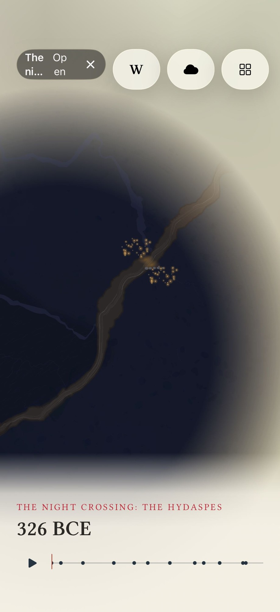 919x2000

← mcp__maestro__inspect_screen: {"ui_schema":{"platform":"ios","abbreviations":{"b":"bounds","txt":"text","rid":"resource-id","a11y":"accessibilityText","hint":"hintText","val":"value","c":"children"},"defaults":{"enabled":true,"focused":false,"selected":false,"checked":false,"txt":"","hint":"","rid":"","val":"","a11y":""}},"elements":[{"b":"[0,0][402,874]","a11y":"Terra Incognita","c":[{"b":"[0,0][402,874]","c":[{"b":"[0,0][402 …

> The chip already shows "The ni…" and "Op / en" broken across lines. Saving evidence, then tapping Alexander's camp.

→ `mcp__maestro__run` `{"device_id": "F0C70C77-E423-4478-B648-3D25045B311B", "yaml": "appId: com.pbordjadze.terraincognita\n---\n- takeScreenshot: /Users/runner/work/_temp/qa/shots/01-start-chip\n- tapOn:\n    point: \"194,354\"\n- takeScreenshot: /Users/runner/work/_temp/qa/shots/02-tap-camp-a"}`

← mcp__maestro__run: {"success":true,"device_id":"F0C70C77-E423-4478-B648-3D25045B311B","commands_executed":4,"message":"Flow executed successfully","env_vars":{"MAESTRO_CLI_ANALYSIS_NOTIFICATION_DISABLED":"true","MAESTRO_CLI_NO_ANALYTICS":"1","MAESTRO_DRIVER_STARTUP_TIMEOUT":"240000","MAESTRO_VERSION":"2.11.0"}}

→ `mcp__maestro__take_screenshot` `{"device_id": "F0C70C77-E423-4478-B648-3D25045B311B"}`

→ `mcp__maestro__inspect_screen` `{"device_id": "F0C70C77-E423-4478-B648-3D25045B311B"}`

← mcp__maestro__take_screenshot: image 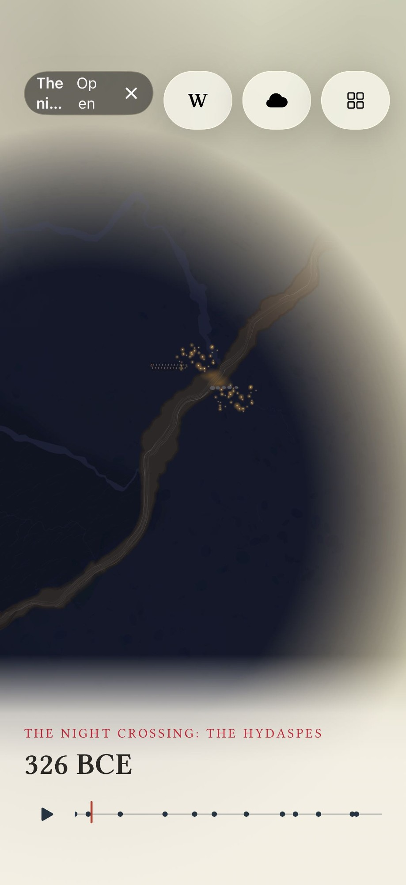 919x2000

← mcp__maestro__inspect_screen: {"ui_schema":{"platform":"ios","abbreviations":{"b":"bounds","txt":"text","rid":"resource-id","a11y":"accessibilityText","hint":"hintText","val":"value","c":"children"},"defaults":{"enabled":true,"focused":false,"selected":false,"checked":false,"txt":"","hint":"","rid":"","val":"","a11y":""}},"elements":[{"b":"[0,0][402,874]","a11y":"Terra Incognita","c":[{"b":"[0,0][402,874]","c":[{"b":"[0,0][402 …

> Tapping the camp started the march: a column appeared and the strip's marker moved. Next I'll drag the column down the valley (southwest along the river).

→ `mcp__maestro__run` `{"device_id": "F0C70C77-E423-4478-B648-3D25045B311B", "yaml": "appId: com.pbordjadze.terraincognita\n---\n- swipe:\n    start: \"166,361\"\n    end: \"140,450\"\n    duration: 1500\n- takeScreenshot: /Users/runner/work/_temp/qa/shots/03-drag-column"}`

→ `mcp__maestro__take_screenshot` `{"device_id": "F0C70C77-E423-4478-B648-3D25045B311B"}`

← mcp__maestro__run: {"success":true,"device_id":"F0C70C77-E423-4478-B648-3D25045B311B","commands_executed":3,"message":"Flow executed successfully","env_vars":{"MAESTRO_CLI_ANALYSIS_NOTIFICATION_DISABLED":"true","MAESTRO_CLI_NO_ANALYTICS":"1","MAESTRO_DRIVER_STARTUP_TIMEOUT":"240000","MAESTRO_VERSION":"2.11.0"}}

← mcp__maestro__take_screenshot: image 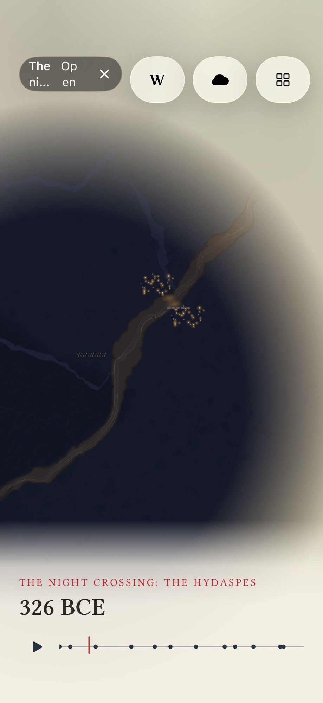 919x2000

> The column followed the drag and the globe stayed still; the strip moved forward. Checking the log.

→ `Read` `{"file_path": "/Users/runner/work/_temp/qa/app.log"}`

← Read: 1	getpwuid_r did not find a match for uid 501
2	Filtering the log data using "subsystem == "com.pbordjadze.terraincognita""
3	Timestamp               Ty Process[PID:TID]
4	2026-10-30 02:36:16.371 I  TerraIncognita[24083:10a4c] [com.pbordjadze.terraincognita:playground] hydaspes r0: started (4 scripts)
5	2026-10-30 02:36:22.856 I  TerraIncognita[24083:10a4c] [com.pbordjadze.terraincognita:playgroun …

→ `Read` `{"file_path": "/Users/runner/work/_temp/qa/crashes.txt"}`

← Read: <system-reminder>Warning: the file exists but the contents are empty.</system-reminder>

> Now dragging the date strip to its middle.

→ `mcp__maestro__run` `{"device_id": "F0C70C77-E423-4478-B648-3D25045B311B", "yaml": "appId: com.pbordjadze.terraincognita\n---\n- swipe:\n    start: \"111,804\"\n    end: \"226,804\"\n    duration: 1500\n- takeScreenshot: /Users/runner/work/_temp/qa/shots/04-strip-middle"}`

→ `mcp__maestro__take_screenshot` `{"device_id": "F0C70C77-E423-4478-B648-3D25045B311B"}`

→ `mcp__maestro__inspect_screen` `{"device_id": "F0C70C77-E423-4478-B648-3D25045B311B"}`

← mcp__maestro__run: {"success":true,"device_id":"F0C70C77-E423-4478-B648-3D25045B311B","commands_executed":3,"message":"Flow executed successfully","env_vars":{"MAESTRO_CLI_ANALYSIS_NOTIFICATION_DISABLED":"true","MAESTRO_CLI_NO_ANALYTICS":"1","MAESTRO_DRIVER_STARTUP_TIMEOUT":"240000","MAESTRO_VERSION":"2.11.0"}}

← mcp__maestro__take_screenshot: image 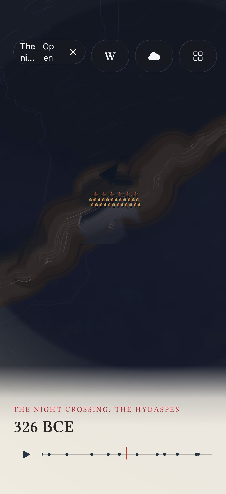 919x2000

← mcp__maestro__inspect_screen: {"ui_schema":{"platform":"ios","abbreviations":{"b":"bounds","txt":"text","rid":"resource-id","a11y":"accessibilityText","hint":"hintText","val":"value","c":"children"},"defaults":{"enabled":true,"focused":false,"selected":false,"checked":false,"txt":"","hint":"","rid":"","val":"","a11y":""}},"elements":[{"b":"[0,0][402,874]","a11y":"Terra Incognita","c":[{"b":"[0,0][402,874]","c":[{"b":"[0,0][402 …

> The camera moved in by itself to the landing on the island. The date strip's value still reads "326 BCE" wherever it sits. No pinch is available, so I'll double-tap the river bend to zoom.

→ `mcp__maestro__run` `{"device_id": "F0C70C77-E423-4478-B648-3D25045B311B", "yaml": "appId: com.pbordjadze.terraincognita\n---\n- doubleTapOn:\n    point: \"200,400\"\n- takeScreenshot: /Users/runner/work/_temp/qa/shots/05-doubletap-bend"}`

→ `mcp__maestro__take_screenshot` `{"device_id": "F0C70C77-E423-4478-B648-3D25045B311B"}`

→ `mcp__maestro__inspect_screen` `{"device_id": "F0C70C77-E423-4478-B648-3D25045B311B"}`

← mcp__maestro__run: {"success":true,"device_id":"F0C70C77-E423-4478-B648-3D25045B311B","commands_executed":3,"message":"Flow executed successfully","env_vars":{"MAESTRO_CLI_ANALYSIS_NOTIFICATION_DISABLED":"true","MAESTRO_CLI_NO_ANALYTICS":"1","MAESTRO_DRIVER_STARTUP_TIMEOUT":"240000","MAESTRO_VERSION":"2.11.0"}}

← mcp__maestro__take_screenshot: image 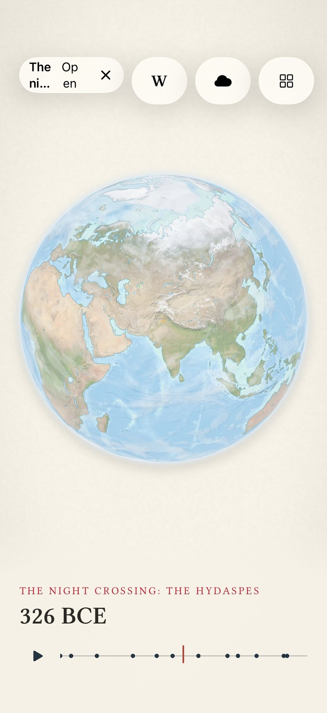 919x2000

← mcp__maestro__inspect_screen: {"ui_schema":{"platform":"ios","abbreviations":{"b":"bounds","txt":"text","rid":"resource-id","a11y":"accessibilityText","hint":"hintText","val":"value","c":"children"},"defaults":{"enabled":true,"focused":false,"selected":false,"checked":false,"txt":"","hint":"","rid":"","val":"","a11y":""}},"elements":[{"b":"[0,0][402,874]","a11y":"Terra Incognita","c":[{"b":"[0,0][402,874]","c":[{"b":"[0,0][402 …

> A double tap aimed to zoom in at the river threw the camera out to the whole Earth. Writing a first report before I try to reproduce it.

→ `Write` `{"file_path": "/Users/runner/work/_temp/qa/report.md", "content": "# Terra Incognita \u2014 exploratory test, The night crossing (Hydaspes)\n\n## Summary\nInterim report. The Hydaspes sequence answers touches (camp tap starts the march, column drag, date strip drag moves the camera to the landing). Found so far: the active-prototype chip truncates/wraps its text (\"The ni\u2026\", \"Op/en\"), and a double tap at the river bend zoomed the camera *out* to the whole Earth instead of in (once so far).\n\n## Coverage\n- Session task: touch camp \u2014 done; drag column \u2014 done; drag strip \u201`

← Write: File created successfully at: /Users/runner/work/_temp/qa/report.md (file state is current in your context — no need to Read it back)

→ `mcp__maestro__run` `{"device_id": "F0C70C77-E423-4478-B648-3D25045B311B", "yaml": "appId: com.pbordjadze.terraincognita\n---\n- tapOn:\n    id: \"globeDatePlay\"\n- takeScreenshot: /Users/runner/work/_temp/qa/shots/06-after-play"}`

← mcp__maestro__run: {"success":true,"device_id":"F0C70C77-E423-4478-B648-3D25045B311B","commands_executed":3,"message":"Flow executed successfully","env_vars":{"MAESTRO_CLI_ANALYSIS_NOTIFICATION_DISABLED":"true","MAESTRO_CLI_NO_ANALYTICS":"1","MAESTRO_DRIVER_STARTUP_TIMEOUT":"240000","MAESTRO_VERSION":"2.11.0"}}

→ `mcp__maestro__take_screenshot` `{"device_id": "F0C70C77-E423-4478-B648-3D25045B311B"}`

← mcp__maestro__take_screenshot: image 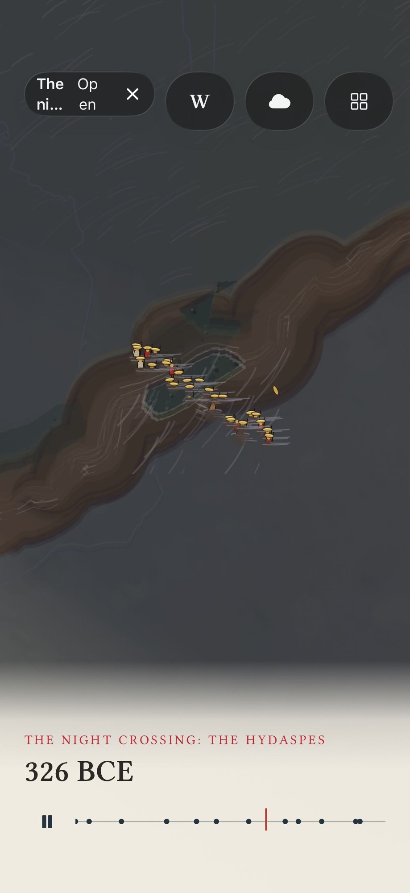 919x2000

> Play resumed and the camera returned to the river. Repeating the double tap.

→ `mcp__maestro__run` `{"device_id": "F0C70C77-E423-4478-B648-3D25045B311B", "yaml": "appId: com.pbordjadze.terraincognita\n---\n- doubleTapOn:\n    point: \"200,400\"\n- takeScreenshot: /Users/runner/work/_temp/qa/shots/07-doubletap-bend-2"}`

→ `mcp__maestro__take_screenshot` `{"device_id": "F0C70C77-E423-4478-B648-3D25045B311B"}`

← mcp__maestro__run: {"success":true,"device_id":"F0C70C77-E423-4478-B648-3D25045B311B","commands_executed":3,"message":"Flow executed successfully","env_vars":{"MAESTRO_CLI_ANALYSIS_NOTIFICATION_DISABLED":"true","MAESTRO_CLI_NO_ANALYTICS":"1","MAESTRO_DRIVER_STARTUP_TIMEOUT":"240000","MAESTRO_VERSION":"2.11.0"}}

← mcp__maestro__take_screenshot: image 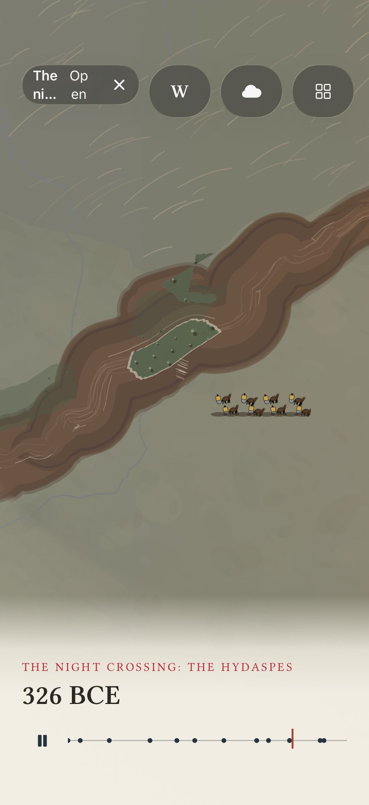 919x2000

> This time the double tap did nothing visible: no zoom and no pause, and the sequence kept playing. So the result is inconsistent. Now letting it play to the end.

→ `mcp__maestro__run` `{"device_id": "F0C70C77-E423-4478-B648-3D25045B311B", "yaml": "appId: com.pbordjadze.terraincognita\n---\n- extendedWaitUntil:\n    visible:\n      id: \"globeDatePlay\"\n      text: \"Play\"\n    timeout: 40000\n- takeScreenshot: /Users/runner/work/_temp/qa/shots/08-end"}`

→ `mcp__maestro__take_screenshot` `{"device_id": "F0C70C77-E423-4478-B648-3D25045B311B"}`

→ `mcp__maestro__inspect_screen` `{"device_id": "F0C70C77-E423-4478-B648-3D25045B311B"}`

← mcp__maestro__run: {"success":true,"device_id":"F0C70C77-E423-4478-B648-3D25045B311B","commands_executed":3,"message":"Flow executed successfully","env_vars":{"MAESTRO_CLI_ANALYSIS_NOTIFICATION_DISABLED":"true","MAESTRO_CLI_NO_ANALYTICS":"1","MAESTRO_DRIVER_STARTUP_TIMEOUT":"240000","MAESTRO_VERSION":"2.11.0"}}

← mcp__maestro__take_screenshot: image 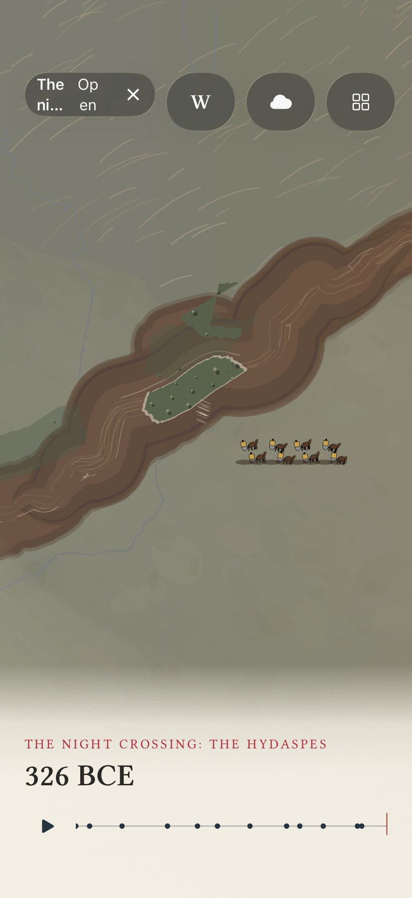 919x2000

← mcp__maestro__inspect_screen: {"ui_schema":{"platform":"ios","abbreviations":{"b":"bounds","txt":"text","rid":"resource-id","a11y":"accessibilityText","hint":"hintText","val":"value","c":"children"},"defaults":{"enabled":true,"focused":false,"selected":false,"checked":false,"txt":"","hint":"","rid":"","val":"","a11y":""}},"elements":[{"b":"[0,0][402,874]","a11y":"Terra Incognita","c":[{"b":"[0,0][402,874]","c":[{"b":"[0,0][402 …

> It played to the end: the marker sits at the right end, Play shows again, and the chariots are bogged. Opening the panel.

→ `mcp__maestro__run` `{"device_id": "F0C70C77-E423-4478-B648-3D25045B311B", "yaml": "appId: com.pbordjadze.terraincognita\n---\n- tapOn:\n    id: \"openActivePrototype\"\n- takeScreenshot: /Users/runner/work/_temp/qa/shots/09-panel"}`

→ `mcp__maestro__take_screenshot` `{"device_id": "F0C70C77-E423-4478-B648-3D25045B311B"}`

→ `mcp__maestro__inspect_screen` `{"device_id": "F0C70C77-E423-4478-B648-3D25045B311B"}`

← mcp__maestro__run: {"success":true,"device_id":"F0C70C77-E423-4478-B648-3D25045B311B","commands_executed":3,"message":"Flow executed successfully","env_vars":{"MAESTRO_CLI_ANALYSIS_NOTIFICATION_DISABLED":"true","MAESTRO_CLI_NO_ANALYTICS":"1","MAESTRO_DRIVER_STARTUP_TIMEOUT":"240000","MAESTRO_VERSION":"2.11.0"}}

← mcp__maestro__take_screenshot: image 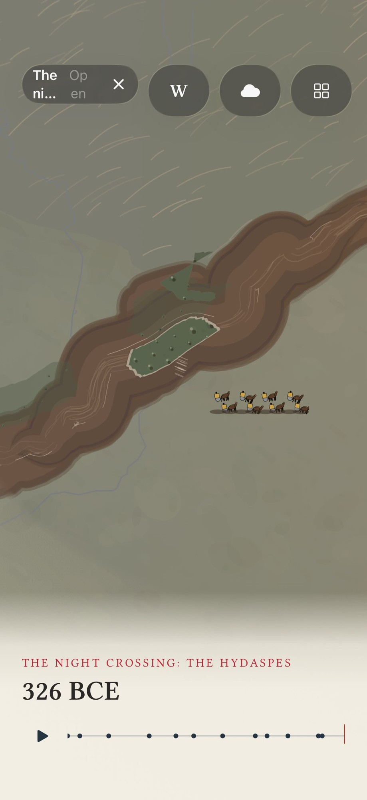 919x2000

← mcp__maestro__inspect_screen: {"ui_schema":{"platform":"ios","abbreviations":{"b":"bounds","txt":"text","rid":"resource-id","a11y":"accessibilityText","hint":"hintText","val":"value","c":"children"},"defaults":{"enabled":true,"focused":false,"selected":false,"checked":false,"txt":"","hint":"","rid":"","val":"","a11y":""}},"elements":[{"b":"[0,0][402,874]","a11y":"Terra Incognita","c":[{"b":"[0,0][402,874]","c":[{"b":"[0,0][402 …

> The hierarchy lists a half-screen panel (`packPanel`), but the screenshot shows no sheet. Taking another screenshot after a moment.

→ `mcp__maestro__take_screenshot` `{"device_id": "F0C70C77-E423-4478-B648-3D25045B311B"}`

← mcp__maestro__take_screenshot: image 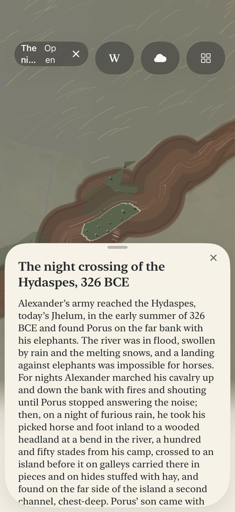 919x2000

→ `mcp__maestro__run` `{"device_id": "F0C70C77-E423-4478-B648-3D25045B311B", "yaml": "appId: com.pbordjadze.terraincognita\n---\n- swipe:\n    start: \"200,820\"\n    end: \"200,480\"\n    duration: 400\n- swipe:\n    start: \"200,820\"\n    end: \"200,480\"\n    duration: 400\n- takeScreenshot: /Users/runner/work/_temp/qa/shots/10-panel-scrolled"}`

→ `mcp__maestro__take_screenshot` `{"device_id": "F0C70C77-E423-4478-B648-3D25045B311B"}`

→ `mcp__maestro__inspect_screen` `{"device_id": "F0C70C77-E423-4478-B648-3D25045B311B"}`

← mcp__maestro__run: {"success":true,"device_id":"F0C70C77-E423-4478-B648-3D25045B311B","commands_executed":4,"message":"Flow executed successfully","env_vars":{"MAESTRO_CLI_ANALYSIS_NOTIFICATION_DISABLED":"true","MAESTRO_CLI_NO_ANALYTICS":"1","MAESTRO_DRIVER_STARTUP_TIMEOUT":"240000","MAESTRO_VERSION":"2.11.0"}}

← mcp__maestro__take_screenshot: image 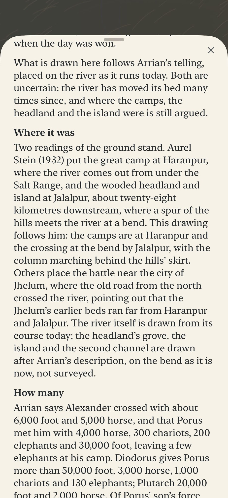 919x2000

← mcp__maestro__inspect_screen: {"ui_schema":{"platform":"ios","abbreviations":{"b":"bounds","txt":"text","rid":"resource-id","a11y":"accessibilityText","hint":"hintText","val":"value","c":"children"},"defaults":{"enabled":true,"focused":false,"selected":false,"checked":false,"txt":"","hint":"","rid":"","val":"","a11y":""}},"elements":[{"b":"[0,0][402,874]","a11y":"Terra Incognita","c":[{"b":"[0,0][402,874]","c":[{"b":"[0,0][402 …

> The panel text is complete. Once the sheet expands, scrolled text runs right under the grabber at the top edge. Closing the panel and ending with ✕.

→ `mcp__maestro__run` `{"device_id": "F0C70C77-E423-4478-B648-3D25045B311B", "yaml": "appId: com.pbordjadze.terraincognita\n---\n- tapOn:\n    id: \"packPanelClose\"\n- takeScreenshot: /Users/runner/work/_temp/qa/shots/11-panel-closed\n- tapOn:\n    id: \"endActivePrototype\"\n- takeScreenshot: /Users/runner/work/_temp/qa/shots/12-ended"}`

→ `mcp__maestro__take_screenshot` `{"device_id": "F0C70C77-E423-4478-B648-3D25045B311B"}`

→ `mcp__maestro__inspect_screen` `{"device_id": "F0C70C77-E423-4478-B648-3D25045B311B"}`

← mcp__maestro__run: {"success":true,"device_id":"F0C70C77-E423-4478-B648-3D25045B311B","commands_executed":5,"message":"Flow executed successfully","env_vars":{"MAESTRO_CLI_ANALYSIS_NOTIFICATION_DISABLED":"true","MAESTRO_CLI_NO_ANALYTICS":"1","MAESTRO_DRIVER_STARTUP_TIMEOUT":"240000","MAESTRO_VERSION":"2.11.0"}}

← mcp__maestro__take_screenshot: image 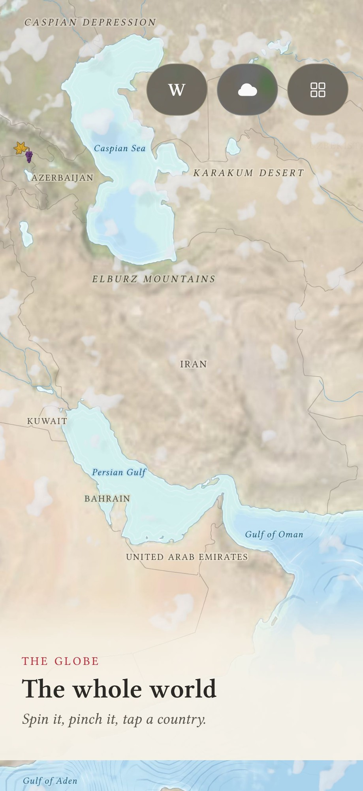 919x2000

← mcp__maestro__inspect_screen: {"ui_schema":{"platform":"ios","abbreviations":{"b":"bounds","txt":"text","rid":"resource-id","a11y":"accessibilityText","hint":"hintText","val":"value","c":"children"},"defaults":{"enabled":true,"focused":false,"selected":false,"checked":false,"txt":"","hint":"","rid":"","val":"","a11y":""}},"elements":[{"b":"[0,0][402,874]","a11y":"Terra Incognita","c":[{"b":"[0,0][402,874]","c":[{"b":"[0,0][402 …

> The plain globe is back, still zoomed in (now over Iran as it turns), with no chip. A blue band of map shows below the cream caption at the bottom edge. Checking that it persists.

→ `mcp__maestro__run` `{"device_id": "F0C70C77-E423-4478-B648-3D25045B311B", "yaml": "appId: com.pbordjadze.terraincognita\n---\n- takeScreenshot: /Users/runner/work/_temp/qa/shots/13-plain-band"}`

← mcp__maestro__run: {"success":true,"device_id":"F0C70C77-E423-4478-B648-3D25045B311B","commands_executed":2,"message":"Flow executed successfully","env_vars":{"MAESTRO_CLI_ANALYSIS_NOTIFICATION_DISABLED":"true","MAESTRO_CLI_NO_ANALYTICS":"1","MAESTRO_DRIVER_STARTUP_TIMEOUT":"240000","MAESTRO_VERSION":"2.11.0"}}

→ `mcp__maestro__take_screenshot` `{"device_id": "F0C70C77-E423-4478-B648-3D25045B311B"}`

← mcp__maestro__take_screenshot: image 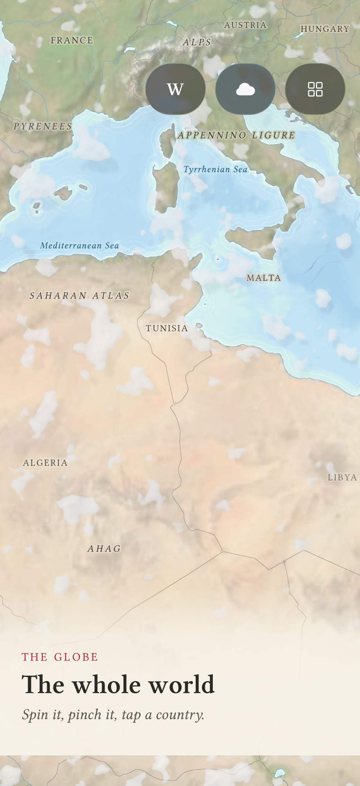 919x2000

→ `mcp__maestro__run` `{"device_id": "F0C70C77-E423-4478-B648-3D25045B311B", "yaml": "appId: com.pbordjadze.terraincognita\n---\n- tapOn:\n    id: \"workbenchButton\"\n- takeScreenshot: /Users/runner/work/_temp/qa/shots/14-workbench"}`

→ `mcp__maestro__inspect_screen` `{"device_id": "F0C70C77-E423-4478-B648-3D25045B311B"}`

← mcp__maestro__run: {"success":true,"device_id":"F0C70C77-E423-4478-B648-3D25045B311B","commands_executed":3,"message":"Flow executed successfully","env_vars":{"MAESTRO_CLI_ANALYSIS_NOTIFICATION_DISABLED":"true","MAESTRO_CLI_NO_ANALYTICS":"1","MAESTRO_DRIVER_STARTUP_TIMEOUT":"240000","MAESTRO_VERSION":"2.11.0"}}

← mcp__maestro__inspect_screen: {"ui_schema":{"platform":"ios","abbreviations":{"b":"bounds","txt":"text","rid":"resource-id","a11y":"accessibilityText","hint":"hintText","val":"value","c":"children"},"defaults":{"enabled":true,"focused":false,"selected":false,"checked":false,"txt":"","hint":"","rid":"","val":"","a11y":""}},"elements":[{"b":"[0,0][402,874]","a11y":"Terra Incognita","c":[{"b":"[0,0][402,874]","c":[{"b":"[0,0][402 …

> The workbench shows the plain globe active and "Again: The night crossing". Restarting the crossing to try reproducing the double-tap zoom-out.

→ `mcp__maestro__run` `{"device_id": "F0C70C77-E423-4478-B648-3D25045B311B", "yaml": "appId: com.pbordjadze.terraincognita\n---\n- tapOn:\n    id: \"prototypeAgain\"\n- takeScreenshot: /Users/runner/work/_temp/qa/shots/15-again"}`

→ `mcp__maestro__take_screenshot` `{"device_id": "F0C70C77-E423-4478-B648-3D25045B311B"}`

← mcp__maestro__run: {"success":true,"device_id":"F0C70C77-E423-4478-B648-3D25045B311B","commands_executed":3,"message":"Flow executed successfully","env_vars":{"MAESTRO_CLI_ANALYSIS_NOTIFICATION_DISABLED":"true","MAESTRO_CLI_NO_ANALYTICS":"1","MAESTRO_DRIVER_STARTUP_TIMEOUT":"240000","MAESTRO_VERSION":"2.11.0"}}

← mcp__maestro__take_screenshot: image 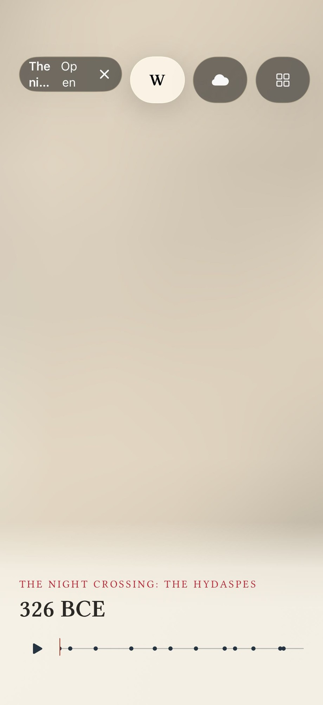 919x2000

> The screen is blank beige: no globe and no night. Waiting a moment and looking again.

→ `mcp__maestro__run` `{"device_id": "F0C70C77-E423-4478-B648-3D25045B311B", "yaml": "appId: com.pbordjadze.terraincognita\n---\n- waitForAnimationToEnd:\n    timeout: 5000\n- takeScreenshot: /Users/runner/work/_temp/qa/shots/16-again-later"}`

→ `mcp__maestro__take_screenshot` `{"device_id": "F0C70C77-E423-4478-B648-3D25045B311B"}`

→ `mcp__maestro__inspect_screen` `{"device_id": "F0C70C77-E423-4478-B648-3D25045B311B"}`

← mcp__maestro__run (error): The user doesn't want to proceed with this tool use. The tool use was rejected (eg. if it was a file edit, the new_string was NOT written to the file). STOP what you are doing and wait for the user to tell you how to proceed.

← mcp__maestro__take_screenshot (error): The user doesn't want to proceed with this tool use. The tool use was rejected (eg. if it was a file edit, the new_string was NOT written to the file). STOP what you are doing and wait for the user to tell you how to proceed.

← mcp__maestro__inspect_screen (error): The user doesn't want to proceed with this tool use. The tool use was rejected (eg. if it was a file edit, the new_string was NOT written to the file). STOP what you are doing and wait for the user to tell you how to proceed.
