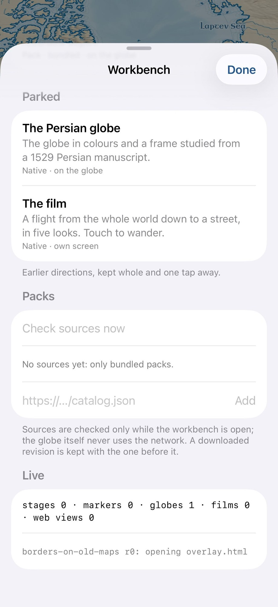
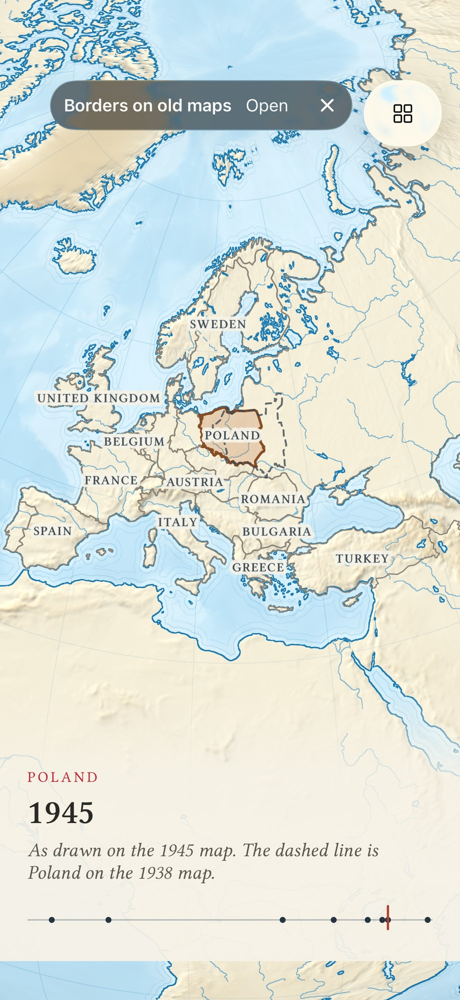
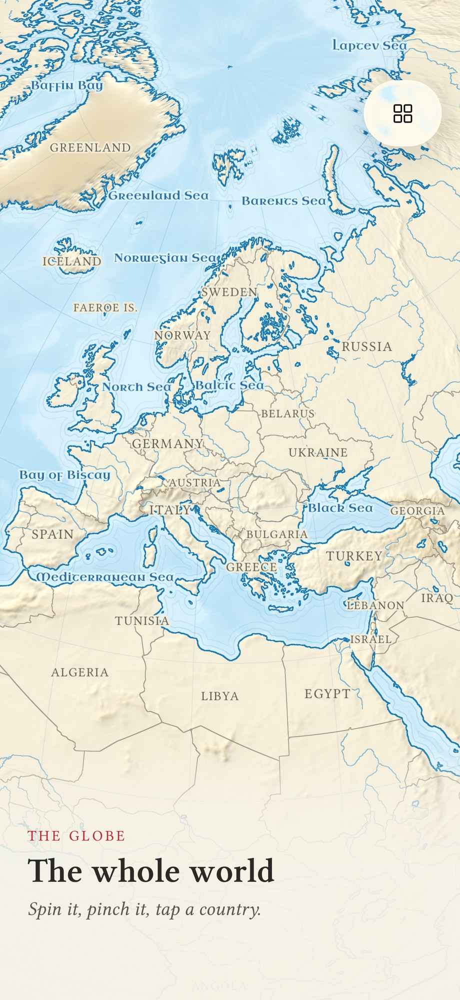

# Agent transcript

- end: error_during_execution, 95 turns, 14.8 min, estimated $1.8325716000000003
- tool calls: {"mcp__maestro__take_screenshot": 29, "Read": 10, "mcp__maestro__run": 35, "mcp__maestro__inspect_screen": 12, "Write": 2}
- images the agent received: 34

**Start**: model claude-opus-5-5, MCP [{"name": "maestro", "status": "connected", "source": "dynamic"}]

→ `mcp__maestro__take_screenshot` `{"device_id": "E839A11B-51B4-4AD3-ACF4-A53B95B7C957"}`

→ `Read` `{"file_path": "/Users/runner/work/_temp/qa/app.log"}`

← mcp__maestro__take_screenshot: image  919x2000

← Read: 1	getpwuid_r did not find a match for uid 501
2	Filtering the log data using "subsystem == "com.pbordjadze.terraincognita""
3

> Open the workbench.

→ `mcp__maestro__run` `{"device_id": "E839A11B-51B4-4AD3-ACF4-A53B95B7C957", "yaml": "appId: com.pbordjadze.terraincognita\n---\n- tapOn:\n    id: workbenchButton\n"}`

→ `mcp__maestro__inspect_screen` `{"device_id": "E839A11B-51B4-4AD3-ACF4-A53B95B7C957"}`

← mcp__maestro__run: {"success":true,"device_id":"E839A11B-51B4-4AD3-ACF4-A53B95B7C957","commands_executed":2,"message":"Flow executed successfully","env_vars":{"MAESTRO_CLI_ANALYSIS_NOTIFICATION_DISABLED":"true","MAESTRO_CLI_NO_ANALYTICS":"1","MAESTRO_DRIVER_STARTUP_TIMEOUT":"240000","MAESTRO_VERSION":"2.11.0"}}

← mcp__maestro__inspect_screen: {"ui_schema":{"platform":"ios","abbreviations":{"b":"bounds","txt":"text","rid":"resource-id","a11y":"accessibilityText","hint":"hintText","val":"value","c":"children"},"defaults":{"enabled":true,"focused":false,"selected":false,"checked":false,"txt":"","hint":"","rid":"","val":"","a11y":""}},"elements":[{"b":"[0,0][402,874]","a11y":"Terra Incognita","c":[{"b":"[0,0][402,874]","c":[{"b":"[0,0][402 …

→ `mcp__maestro__run` `{"device_id": "E839A11B-51B4-4AD3-ACF4-A53B95B7C957", "yaml": "appId: com.pbordjadze.terraincognita\n---\n- scrollUntilVisible:\n    element:\n      id: prototype_sounding-the-deep\n    direction: DOWN\n- takeScreenshot: /Users/runner/work/_temp/qa/shots/workbench-sounding\n"}`

→ `mcp__maestro__take_screenshot` `{"device_id": "E839A11B-51B4-4AD3-ACF4-A53B95B7C957"}`

← mcp__maestro__run: {"success":true,"device_id":"E839A11B-51B4-4AD3-ACF4-A53B95B7C957","commands_executed":3,"message":"Flow executed successfully","env_vars":{"MAESTRO_CLI_ANALYSIS_NOTIFICATION_DISABLED":"true","MAESTRO_CLI_NO_ANALYTICS":"1","MAESTRO_DRIVER_STARTUP_TIMEOUT":"240000","MAESTRO_VERSION":"2.11.0"}}

← mcp__maestro__take_screenshot: image  919x2000

→ `mcp__maestro__run` `{"device_id": "E839A11B-51B4-4AD3-ACF4-A53B95B7C957", "yaml": "appId: com.pbordjadze.terraincognita\n---\n- scrollUntilVisible:\n    element:\n      id: playgroundLive\n    direction: DOWN\n- takeScreenshot: /Users/runner/work/_temp/qa/shots/workbench-live-initial\n"}`

→ `mcp__maestro__take_screenshot` `{"device_id": "E839A11B-51B4-4AD3-ACF4-A53B95B7C957"}`

← mcp__maestro__run: {"success":true,"device_id":"E839A11B-51B4-4AD3-ACF4-A53B95B7C957","commands_executed":3,"message":"Flow executed successfully","env_vars":{"MAESTRO_CLI_ANALYSIS_NOTIFICATION_DISABLED":"true","MAESTRO_CLI_NO_ANALYTICS":"1","MAESTRO_DRIVER_STARTUP_TIMEOUT":"240000","MAESTRO_VERSION":"2.11.0"}}

← mcp__maestro__take_screenshot: image  919x2000

> Baseline Live: stages 0 · markers 0 · globes 1 · films 0 · web views 0. Start Sounding the deep.

→ `mcp__maestro__run` `{"device_id": "E839A11B-51B4-4AD3-ACF4-A53B95B7C957", "yaml": "appId: com.pbordjadze.terraincognita\n---\n- tapOn:\n    id: prototype_sounding-the-deep\n- takeScreenshot: /Users/runner/work/_temp/qa/shots/sounding-open\n"}`

→ `mcp__maestro__take_screenshot` `{"device_id": "E839A11B-51B4-4AD3-ACF4-A53B95B7C957"}`

← mcp__maestro__run: {"success":true,"device_id":"E839A11B-51B4-4AD3-ACF4-A53B95B7C957","commands_executed":3,"message":"Flow executed successfully","env_vars":{"MAESTRO_CLI_ANALYSIS_NOTIFICATION_DISABLED":"true","MAESTRO_CLI_NO_ANALYTICS":"1","MAESTRO_DRIVER_STARTUP_TIMEOUT":"240000","MAESTRO_VERSION":"2.11.0"}}

← mcp__maestro__take_screenshot: image  919x2000

> Workbench closed but the plain globe is still shown, no chip. Let me check the log and look again.

→ `Read` `{"file_path": "/Users/runner/work/_temp/qa/app.log"}`

← Read: Wasted call — file unchanged since your last Read. Refer to that earlier tool_result instead.

→ `mcp__maestro__inspect_screen` `{"device_id": "E839A11B-51B4-4AD3-ACF4-A53B95B7C957"}`

← mcp__maestro__inspect_screen: {"ui_schema":{"platform":"ios","abbreviations":{"b":"bounds","txt":"text","rid":"resource-id","a11y":"accessibilityText","hint":"hintText","val":"value","c":"children"},"defaults":{"enabled":true,"focused":false,"selected":false,"checked":false,"txt":"","hint":"","rid":"","val":"","a11y":""}},"elements":[{"b":"[0,0][402,874]","a11y":"Terra Incognita","c":[{"b":"[0,0][402,874]","c":[{"b":"[0,0][402 …

> The tap probably landed on the header (the row was scrolled under it). Retry with the row in view.

→ `mcp__maestro__run` `{"device_id": "E839A11B-51B4-4AD3-ACF4-A53B95B7C957", "yaml": "appId: com.pbordjadze.terraincognita\n---\n- tapOn:\n    id: workbenchButton\n- scrollUntilVisible:\n    element:\n      text: \"Sounding the deep\"\n    direction: DOWN\n    centerElement: true\n- tapOn: \"Sounding the deep\"\n- takeScreenshot: /Users/runner/work/_temp/qa/shots/sounding-open\n"}`

→ `mcp__maestro__take_screenshot` `{"device_id": "E839A11B-51B4-4AD3-ACF4-A53B95B7C957"}`

← mcp__maestro__run: {"success":true,"device_id":"E839A11B-51B4-4AD3-ACF4-A53B95B7C957","commands_executed":5,"message":"Flow executed successfully","env_vars":{"MAESTRO_CLI_ANALYSIS_NOTIFICATION_DISABLED":"true","MAESTRO_CLI_NO_ANALYTICS":"1","MAESTRO_DRIVER_STARTUP_TIMEOUT":"240000","MAESTRO_VERSION":"2.11.0"}}

← mcp__maestro__take_screenshot: image  919x2000

> Chip is up and the globe faces the Atlantic, but today's borders/names and the plain globe's foot remain, with no date strip. Let me wait and look again.

→ `mcp__maestro__run` `{"device_id": "E839A11B-51B4-4AD3-ACF4-A53B95B7C957", "yaml": "appId: com.pbordjadze.terraincognita\n---\n- waitForAnimationToEnd:\n    timeout: 4000\n- takeScreenshot: /Users/runner/work/_temp/qa/shots/sounding-after-wait\n"}`

→ `mcp__maestro__inspect_screen` `{"device_id": "E839A11B-51B4-4AD3-ACF4-A53B95B7C957"}`

→ `Read` `{"file_path": "/Users/runner/work/_temp/qa/app.log"}`

← mcp__maestro__run: {"success":true,"device_id":"E839A11B-51B4-4AD3-ACF4-A53B95B7C957","commands_executed":3,"message":"Flow executed successfully","env_vars":{"MAESTRO_CLI_ANALYSIS_NOTIFICATION_DISABLED":"true","MAESTRO_CLI_NO_ANALYTICS":"1","MAESTRO_DRIVER_STARTUP_TIMEOUT":"240000","MAESTRO_VERSION":"2.11.0"}}

← mcp__maestro__inspect_screen: {"ui_schema":{"platform":"ios","abbreviations":{"b":"bounds","txt":"text","rid":"resource-id","a11y":"accessibilityText","hint":"hintText","val":"value","c":"children"},"defaults":{"enabled":true,"focused":false,"selected":false,"checked":false,"txt":"","hint":"","rid":"","val":"","a11y":""}},"elements":[{"b":"[0,0][402,874]","a11y":"Terra Incognita","c":[{"b":"[0,0][402,874]","c":[{"b":"[0,0][402 …

← Read: 1	getpwuid_r did not find a match for uid 501
2	Filtering the log data using "subsystem == "com.pbordjadze.terraincognita""
3	Timestamp               Ty Process[PID:TID]
4	2026-10-28 04:47:21.535 I  TerraIncognita[11473:99d3] [com.pbordjadze.terraincognita:playground] sounding-the-deep r0: opening overlay.html
5

→ `mcp__maestro__take_screenshot` `{"device_id": "E839A11B-51B4-4AD3-ACF4-A53B95B7C957"}`

← mcp__maestro__take_screenshot: image  919x2000

> Loaded now (borders and names gone, date strip and ship present). Zoom in on the ship with a double tap.

→ `mcp__maestro__run` `{"device_id": "E839A11B-51B4-4AD3-ACF4-A53B95B7C957", "yaml": "appId: com.pbordjadze.terraincognita\n---\n- doubleTapOn:\n    point: \"137,328\"\n- takeScreenshot: /Users/runner/work/_temp/qa/shots/sounding-zoom1\n"}`

→ `mcp__maestro__take_screenshot` `{"device_id": "E839A11B-51B4-4AD3-ACF4-A53B95B7C957"}`

← mcp__maestro__run: {"success":true,"device_id":"E839A11B-51B4-4AD3-ACF4-A53B95B7C957","commands_executed":3,"message":"Flow executed successfully","env_vars":{"MAESTRO_CLI_ANALYSIS_NOTIFICATION_DISABLED":"true","MAESTRO_CLI_NO_ANALYTICS":"1","MAESTRO_DRIVER_STARTUP_TIMEOUT":"240000","MAESTRO_VERSION":"2.11.0"}}

← mcp__maestro__take_screenshot: image  919x2000

> Zoomed one step; no stations yet. The ship moves fast — pause, then double tap on the ship again.

→ `mcp__maestro__run` `{"device_id": "E839A11B-51B4-4AD3-ACF4-A53B95B7C957", "yaml": "appId: com.pbordjadze.terraincognita\n---\n- tapOn:\n    id: globeDatePlay\n- takeScreenshot: /Users/runner/work/_temp/qa/shots/sounding-paused\n"}`

→ `mcp__maestro__take_screenshot` `{"device_id": "E839A11B-51B4-4AD3-ACF4-A53B95B7C957"}`

← mcp__maestro__run: {"success":true,"device_id":"E839A11B-51B4-4AD3-ACF4-A53B95B7C957","commands_executed":3,"message":"Flow executed successfully","env_vars":{"MAESTRO_CLI_ANALYSIS_NOTIFICATION_DISABLED":"true","MAESTRO_CLI_NO_ANALYTICS":"1","MAESTRO_DRIVER_STARTUP_TIMEOUT":"240000","MAESTRO_VERSION":"2.11.0"}}

← mcp__maestro__take_screenshot: image  919x2000

> Stations appear (filled and hollow, dashed passages). Paused at 23 Dec 1873. Touch a station.

→ `mcp__maestro__run` `{"device_id": "E839A11B-51B4-4AD3-ACF4-A53B95B7C957", "yaml": "appId: com.pbordjadze.terraincognita\n---\n- tapOn:\n    point: \"252,517\"\n- takeScreenshot: /Users/runner/work/_temp/qa/shots/sounding-station1\n"}`

→ `mcp__maestro__take_screenshot` `{"device_id": "E839A11B-51B4-4AD3-ACF4-A53B95B7C957"}`

← mcp__maestro__run: {"success":true,"device_id":"E839A11B-51B4-4AD3-ACF4-A53B95B7C957","commands_executed":3,"message":"Flow executed successfully","env_vars":{"MAESTRO_CLI_ANALYSIS_NOTIFICATION_DISABLED":"true","MAESTRO_CLI_NO_ANALYTICS":"1","MAESTRO_DRIVER_STARTUP_TIMEOUT":"240000","MAESTRO_VERSION":"2.11.0"}}

← mcp__maestro__take_screenshot: image  919x2000

→ `mcp__maestro__run` `{"device_id": "E839A11B-51B4-4AD3-ACF4-A53B95B7C957", "yaml": "appId: com.pbordjadze.terraincognita\n---\n- tapOn:\n    point: \"226,804\"\n- takeScreenshot: /Users/runner/work/_temp/qa/shots/sounding-date-mid\n"}`

→ `mcp__maestro__take_screenshot` `{"device_id": "E839A11B-51B4-4AD3-ACF4-A53B95B7C957"}`

← mcp__maestro__run: {"success":true,"device_id":"E839A11B-51B4-4AD3-ACF4-A53B95B7C957","commands_executed":3,"message":"Flow executed successfully","env_vars":{"MAESTRO_CLI_ANALYSIS_NOTIFICATION_DISABLED":"true","MAESTRO_CLI_NO_ANALYTICS":"1","MAESTRO_DRIVER_STARTUP_TIMEOUT":"240000","MAESTRO_VERSION":"2.11.0"}}

← mcp__maestro__take_screenshot: image  919x2000

> Gap message shows correctly. Let me write the first report now.

→ `Write` `{"file_path": "/Users/runner/work/_temp/qa/report.md", "content": "# Terra Incognita \u2013 exploratory test: \"Sounding the deep\" and \"Borders on old maps\"\n\n(iPhone 17 Pro simulator, release build. Report in progress.)\n\n## Summary\nSounding the deep starts and works: date plays and pauses, stations appear when zoomed, touching a station sets the date and lowers a labelled line, a gap in the record hides the ship and the foot explains why. Readability problems: the depth label is pale and drawn over land, the ship's label covers a station, and dots show through the foot. Opening the pro`

← Write: File created successfully at: /Users/runner/work/_temp/qa/report.md (file state is current in your context — no need to Read it back)

→ `mcp__maestro__run` `{"device_id": "E839A11B-51B4-4AD3-ACF4-A53B95B7C957", "yaml": "appId: com.pbordjadze.terraincognita\n---\n- tapOn:\n    id: openActivePrototype\n- takeScreenshot: /Users/runner/work/_temp/qa/shots/sounding-about\n"}`

← mcp__maestro__run: {"success":true,"device_id":"E839A11B-51B4-4AD3-ACF4-A53B95B7C957","commands_executed":3,"message":"Flow executed successfully","env_vars":{"MAESTRO_CLI_ANALYSIS_NOTIFICATION_DISABLED":"true","MAESTRO_CLI_NO_ANALYTICS":"1","MAESTRO_DRIVER_STARTUP_TIMEOUT":"240000","MAESTRO_VERSION":"2.11.0"}}

→ `mcp__maestro__take_screenshot` `{"device_id": "E839A11B-51B4-4AD3-ACF4-A53B95B7C957"}`

→ `mcp__maestro__inspect_screen` `{"device_id": "E839A11B-51B4-4AD3-ACF4-A53B95B7C957"}`

← mcp__maestro__take_screenshot: image  919x2000

← mcp__maestro__inspect_screen: {"ui_schema":{"platform":"ios","abbreviations":{"b":"bounds","txt":"text","rid":"resource-id","a11y":"accessibilityText","hint":"hintText","val":"value","c":"children"},"defaults":{"enabled":true,"focused":false,"selected":false,"checked":false,"txt":"","hint":"","rid":"","val":"","a11y":""}},"elements":[{"b":"[0,0][402,874]","a11y":"Terra Incognita","c":[{"b":"[0,0][402,874]","c":[{"b":"[0,0][402 …

> The About page is blank. Wait and check again, plus the log.

→ `mcp__maestro__run` `{"device_id": "E839A11B-51B4-4AD3-ACF4-A53B95B7C957", "yaml": "appId: com.pbordjadze.terraincognita\n---\n- waitForAnimationToEnd:\n    timeout: 5000\n- takeScreenshot: /Users/runner/work/_temp/qa/shots/sounding-about-wait\n"}`

→ `Read` `{"file_path": "/Users/runner/work/_temp/qa/app.log"}`

← mcp__maestro__run: {"success":true,"device_id":"E839A11B-51B4-4AD3-ACF4-A53B95B7C957","commands_executed":3,"message":"Flow executed successfully","env_vars":{"MAESTRO_CLI_ANALYSIS_NOTIFICATION_DISABLED":"true","MAESTRO_CLI_NO_ANALYTICS":"1","MAESTRO_DRIVER_STARTUP_TIMEOUT":"240000","MAESTRO_VERSION":"2.11.0"}}

← Read: 1	getpwuid_r did not find a match for uid 501
2	Filtering the log data using "subsystem == "com.pbordjadze.terraincognita""
3	Timestamp               Ty Process[PID:TID]
4	2026-10-28 04:47:21.535 I  TerraIncognita[11473:99d3] [com.pbordjadze.terraincognita:playground] sounding-the-deep r0: opening overlay.html
5	2026-10-28 04:49:20.223 I  TerraIncognita[11473:99d3] [com.pbordjadze.terraincognita:p …

→ `mcp__maestro__take_screenshot` `{"device_id": "E839A11B-51B4-4AD3-ACF4-A53B95B7C957"}`

← mcp__maestro__take_screenshot: image  919x2000

> Still blank (only Back; the scroll bars say "1 page"). Try scrolling, then Back.

→ `mcp__maestro__run` `{"device_id": "E839A11B-51B4-4AD3-ACF4-A53B95B7C957", "yaml": "appId: com.pbordjadze.terraincognita\n---\n- swipe:\n    start: \"50%,70%\"\n    end: \"50%,30%\"\n    duration: 600\n- takeScreenshot: /Users/runner/work/_temp/qa/shots/sounding-about-scrolled\n- tapOn:\n    id: packBack\n- takeScreenshot: /Users/runner/work/_temp/qa/shots/sounding-after-back\n"}`

→ `mcp__maestro__take_screenshot` `{"device_id": "E839A11B-51B4-4AD3-ACF4-A53B95B7C957"}`

← mcp__maestro__run: {"success":true,"device_id":"E839A11B-51B4-4AD3-ACF4-A53B95B7C957","commands_executed":5,"message":"Flow executed successfully","env_vars":{"MAESTRO_CLI_ANALYSIS_NOTIFICATION_DISABLED":"true","MAESTRO_CLI_NO_ANALYTICS":"1","MAESTRO_DRIVER_STARTUP_TIMEOUT":"240000","MAESTRO_VERSION":"2.11.0"}}

← mcp__maestro__take_screenshot: image  919x2000

> Back returns with date and state kept (the globe sits about 25 pt higher than before). Retry Open to see if the blank About page repeats.

→ `mcp__maestro__run` `{"device_id": "E839A11B-51B4-4AD3-ACF4-A53B95B7C957", "yaml": "appId: com.pbordjadze.terraincognita\n---\n- tapOn:\n    id: openActivePrototype\n- waitForAnimationToEnd:\n    timeout: 5000\n- takeScreenshot: /Users/runner/work/_temp/qa/shots/sounding-about-2\n"}`

→ `mcp__maestro__take_screenshot` `{"device_id": "E839A11B-51B4-4AD3-ACF4-A53B95B7C957"}`

← mcp__maestro__run: {"success":true,"device_id":"E839A11B-51B4-4AD3-ACF4-A53B95B7C957","commands_executed":4,"message":"Flow executed successfully","env_vars":{"MAESTRO_CLI_ANALYSIS_NOTIFICATION_DISABLED":"true","MAESTRO_CLI_NO_ANALYTICS":"1","MAESTRO_DRIVER_STARTUP_TIMEOUT":"240000","MAESTRO_VERSION":"2.11.0"}}

← mcp__maestro__take_screenshot: image  919x2000

> Second Open shows the page, so the blank first open happened 1 of 2 times. Scroll to the sources.

→ `mcp__maestro__run` `{"device_id": "E839A11B-51B4-4AD3-ACF4-A53B95B7C957", "yaml": "appId: com.pbordjadze.terraincognita\n---\n- swipe:\n    start: \"50%,80%\"\n    end: \"50%,20%\"\n    duration: 800\n- swipe:\n    start: \"50%,80%\"\n    end: \"50%,20%\"\n    duration: 800\n- takeScreenshot: /Users/runner/work/_temp/qa/shots/sounding-about-sources\n"}`

→ `mcp__maestro__take_screenshot` `{"device_id": "E839A11B-51B4-4AD3-ACF4-A53B95B7C957"}`

← mcp__maestro__run: {"success":true,"device_id":"E839A11B-51B4-4AD3-ACF4-A53B95B7C957","commands_executed":4,"message":"Flow executed successfully","env_vars":{"MAESTRO_CLI_ANALYSIS_NOTIFICATION_DISABLED":"true","MAESTRO_CLI_NO_ANALYTICS":"1","MAESTRO_DRIVER_STARTUP_TIMEOUT":"240000","MAESTRO_VERSION":"2.11.0"}}

← mcp__maestro__take_screenshot: image  919x2000

> Sources present; the floating Back button covers the start of the "What this record is" text while scrolled (minor). Now Back, then ✕, then check the Live line.

→ `mcp__maestro__run` `{"device_id": "E839A11B-51B4-4AD3-ACF4-A53B95B7C957", "yaml": "appId: com.pbordjadze.terraincognita\n---\n- tapOn:\n    id: packBack\n- tapOn:\n    id: endActivePrototype\n- takeScreenshot: /Users/runner/work/_temp/qa/shots/sounding-ended\n"}`

→ `mcp__maestro__take_screenshot` `{"device_id": "E839A11B-51B4-4AD3-ACF4-A53B95B7C957"}`

← mcp__maestro__run: {"success":true,"device_id":"E839A11B-51B4-4AD3-ACF4-A53B95B7C957","commands_executed":4,"message":"Flow executed successfully","env_vars":{"MAESTRO_CLI_ANALYSIS_NOTIFICATION_DISABLED":"true","MAESTRO_CLI_NO_ANALYTICS":"1","MAESTRO_DRIVER_STARTUP_TIMEOUT":"240000","MAESTRO_VERSION":"2.11.0"}}

← mcp__maestro__take_screenshot: image  919x2000

> Plain globe, borders and names back (it keeps the zoom). Check the Live line.

→ `mcp__maestro__run` `{"device_id": "E839A11B-51B4-4AD3-ACF4-A53B95B7C957", "yaml": "appId: com.pbordjadze.terraincognita\n---\n- tapOn:\n    id: workbenchButton\n- scrollUntilVisible:\n    element:\n      id: playgroundLive\n    direction: DOWN\n- takeScreenshot: /Users/runner/work/_temp/qa/shots/live-after-sounding\n"}`

→ `mcp__maestro__take_screenshot` `{"device_id": "E839A11B-51B4-4AD3-ACF4-A53B95B7C957"}`

← mcp__maestro__run: {"success":true,"device_id":"E839A11B-51B4-4AD3-ACF4-A53B95B7C957","commands_executed":4,"message":"Flow executed successfully","env_vars":{"MAESTRO_CLI_ANALYSIS_NOTIFICATION_DISABLED":"true","MAESTRO_CLI_NO_ANALYTICS":"1","MAESTRO_DRIVER_STARTUP_TIMEOUT":"240000","MAESTRO_VERSION":"2.11.0"}}

← mcp__maestro__take_screenshot: image  919x2000

> Live is back to baseline. Now start Borders on old maps.

→ `mcp__maestro__run` `{"device_id": "E839A11B-51B4-4AD3-ACF4-A53B95B7C957", "yaml": "appId: com.pbordjadze.terraincognita\n---\n- scrollUntilVisible:\n    element:\n      text: \"Borders on old maps\"\n    direction: UP\n    centerElement: true\n- tapOn: \"Borders on old maps\"\n- waitForAnimationToEnd:\n    timeout: 4000\n- takeScreenshot: /Users/runner/work/_temp/qa/shots/borders-open\n"}`

→ `mcp__maestro__take_screenshot` `{"device_id": "E839A11B-51B4-4AD3-ACF4-A53B95B7C957"}`

→ `mcp__maestro__inspect_screen` `{"device_id": "E839A11B-51B4-4AD3-ACF4-A53B95B7C957"}`

← mcp__maestro__run: {"success":true,"device_id":"E839A11B-51B4-4AD3-ACF4-A53B95B7C957","commands_executed":5,"message":"Flow executed successfully","env_vars":{"MAESTRO_CLI_ANALYSIS_NOTIFICATION_DISABLED":"true","MAESTRO_CLI_NO_ANALYTICS":"1","MAESTRO_DRIVER_STARTUP_TIMEOUT":"240000","MAESTRO_VERSION":"2.11.0"}}

← mcp__maestro__take_screenshot: image  919x2000

← mcp__maestro__inspect_screen: {"ui_schema":{"platform":"ios","abbreviations":{"b":"bounds","txt":"text","rid":"resource-id","a11y":"accessibilityText","hint":"hintText","val":"value","c":"children"},"defaults":{"enabled":true,"focused":false,"selected":false,"checked":false,"txt":"","hint":"","rid":"","val":"","a11y":""}},"elements":[{"b":"[0,0][402,874]","a11y":"Terra Incognita","c":[{"b":"[0,0][402,874]","c":[{"b":"[0,0][402 …

> Opened on 1875 (near the previous 19 Sep 1874 ✓) but with Poland chosen on a map without Poland. There's also a strip of globe showing below the date strip again. Tap the last tick.

→ `mcp__maestro__run` `{"device_id": "E839A11B-51B4-4AD3-ACF4-A53B95B7C957", "yaml": "appId: com.pbordjadze.terraincognita\n---\n- tapOn:\n    point: \"373,804\"\n- takeScreenshot: /Users/runner/work/_temp/qa/shots/borders-last-tick\n"}`

→ `mcp__maestro__take_screenshot` `{"device_id": "E839A11B-51B4-4AD3-ACF4-A53B95B7C957"}`

← mcp__maestro__run: {"success":true,"device_id":"E839A11B-51B4-4AD3-ACF4-A53B95B7C957","commands_executed":3,"message":"Flow executed successfully","env_vars":{"MAESTRO_CLI_ANALYSIS_NOTIFICATION_DISABLED":"true","MAESTRO_CLI_NO_ANALYTICS":"1","MAESTRO_DRIVER_STARTUP_TIMEOUT":"240000","MAESTRO_VERSION":"2.11.0"}}

← mcp__maestro__take_screenshot: image  919x2000

> 1993 shown when touching the 1994 tick, and no GERMANY label though Belgium and Lithuania are named. Take another screenshot to confirm the label.

→ `mcp__maestro__take_screenshot` `{"device_id": "E839A11B-51B4-4AD3-ACF4-A53B95B7C957"}`

← mcp__maestro__take_screenshot: image  919x2000

> GERMANY's label is missing in both screenshots, and no dashed outline is visible (1945 and 1994 Poland nearly coincide). Tap Germany.

→ `mcp__maestro__run` `{"device_id": "E839A11B-51B4-4AD3-ACF4-A53B95B7C957", "yaml": "appId: com.pbordjadze.terraincognita\n---\n- tapOn:\n    point: \"155,388\"\n- takeScreenshot: /Users/runner/work/_temp/qa/shots/borders-germany\n"}`

→ `mcp__maestro__take_screenshot` `{"device_id": "E839A11B-51B4-4AD3-ACF4-A53B95B7C957"}`

← mcp__maestro__run: {"success":true,"device_id":"E839A11B-51B4-4AD3-ACF4-A53B95B7C957","commands_executed":3,"message":"Flow executed successfully","env_vars":{"MAESTRO_CLI_ANALYSIS_NOTIFICATION_DISABLED":"true","MAESTRO_CLI_NO_ANALYTICS":"1","MAESTRO_DRIVER_STARTUP_TIMEOUT":"240000","MAESTRO_VERSION":"2.11.0"}}

← mcp__maestro__take_screenshot: image  919x2000

> Choosing Germany works, with the dashed 1938 outline. Labels shift with the choice (Poland, Belgium, Lithuania vanish; Latvia and Byelarus appear). Now tap the sea (Mediterranean).

→ `mcp__maestro__run` `{"device_id": "E839A11B-51B4-4AD3-ACF4-A53B95B7C957", "yaml": "appId: com.pbordjadze.terraincognita\n---\n- tapOn:\n    point: \"95,500\"\n- takeScreenshot: /Users/runner/work/_temp/qa/shots/borders-sea\n"}`

→ `mcp__maestro__take_screenshot` `{"device_id": "E839A11B-51B4-4AD3-ACF4-A53B95B7C957"}`

← mcp__maestro__run: {"success":true,"device_id":"E839A11B-51B4-4AD3-ACF4-A53B95B7C957","commands_executed":3,"message":"Flow executed successfully","env_vars":{"MAESTRO_CLI_ANALYSIS_NOTIFICATION_DISABLED":"true","MAESTRO_CLI_NO_ANALYTICS":"1","MAESTRO_DRIVER_STARTUP_TIMEOUT":"240000","MAESTRO_VERSION":"2.11.0"}}

← mcp__maestro__take_screenshot: image  919x2000

> Sea clears the choice ✓. Now with nothing chosen, POLAND is unlabelled though there's room. Tap Africa (likely outside coverage).

→ `mcp__maestro__run` `{"device_id": "E839A11B-51B4-4AD3-ACF4-A53B95B7C957", "yaml": "appId: com.pbordjadze.terraincognita\n---\n- tapOn:\n    point: \"131,612\"\n- takeScreenshot: /Users/runner/work/_temp/qa/shots/borders-africa\n"}`

→ `mcp__maestro__inspect_screen` `{"device_id": "E839A11B-51B4-4AD3-ACF4-A53B95B7C957"}`

← mcp__maestro__run: {"success":true,"device_id":"E839A11B-51B4-4AD3-ACF4-A53B95B7C957","commands_executed":3,"message":"Flow executed successfully","env_vars":{"MAESTRO_CLI_ANALYSIS_NOTIFICATION_DISABLED":"true","MAESTRO_CLI_NO_ANALYTICS":"1","MAESTRO_DRIVER_STARTUP_TIMEOUT":"240000","MAESTRO_VERSION":"2.11.0"}}

← mcp__maestro__inspect_screen: {"ui_schema":{"platform":"ios","abbreviations":{"b":"bounds","txt":"text","rid":"resource-id","a11y":"accessibilityText","hint":"hintText","val":"value","c":"children"},"defaults":{"enabled":true,"focused":false,"selected":false,"checked":false,"txt":"","hint":"","rid":"","val":"","a11y":""}},"elements":[{"b":"[0,0][402,874]","a11y":"Terra Incognita","c":[{"b":"[0,0][402,874]","c":[{"b":"[0,0][402 …

> Out-of-coverage message correct. Now touch the first tick on the date strip.

→ `mcp__maestro__run` `{"device_id": "E839A11B-51B4-4AD3-ACF4-A53B95B7C957", "yaml": "appId: com.pbordjadze.terraincognita\n---\n- tapOn:\n    point: \"45,804\"\n- takeScreenshot: /Users/runner/work/_temp/qa/shots/borders-first-tick\n"}`

→ `mcp__maestro__take_screenshot` `{"device_id": "E839A11B-51B4-4AD3-ACF4-A53B95B7C957"}`

← mcp__maestro__run: {"success":true,"device_id":"E839A11B-51B4-4AD3-ACF4-A53B95B7C957","commands_executed":3,"message":"Flow executed successfully","env_vars":{"MAESTRO_CLI_ANALYSIS_NOTIFICATION_DISABLED":"true","MAESTRO_CLI_NO_ANALYTICS":"1","MAESTRO_DRIVER_STARTUP_TIMEOUT":"240000","MAESTRO_VERSION":"2.11.0"}}

← mcp__maestro__take_screenshot: image  919x2000

> First tick gives exactly 1530. Repeat the last-tick touch to see if it gives 1993 again.

→ `mcp__maestro__run` `{"device_id": "E839A11B-51B4-4AD3-ACF4-A53B95B7C957", "yaml": "appId: com.pbordjadze.terraincognita\n---\n- tapOn:\n    point: \"373,804\"\n- takeScreenshot: /Users/runner/work/_temp/qa/shots/borders-last-tick-2\n- tapOn:\n    point: \"376,804\"\n- takeScreenshot: /Users/runner/work/_temp/qa/shots/borders-last-tick-3\n"}`

→ `mcp__maestro__inspect_screen` `{"device_id": "E839A11B-51B4-4AD3-ACF4-A53B95B7C957"}`

← mcp__maestro__run: {"success":true,"device_id":"E839A11B-51B4-4AD3-ACF4-A53B95B7C957","commands_executed":5,"message":"Flow executed successfully","env_vars":{"MAESTRO_CLI_ANALYSIS_NOTIFICATION_DISABLED":"true","MAESTRO_CLI_NO_ANALYTICS":"1","MAESTRO_DRIVER_STARTUP_TIMEOUT":"240000","MAESTRO_VERSION":"2.11.0"}}

← mcp__maestro__inspect_screen: {"ui_schema":{"platform":"ios","abbreviations":{"b":"bounds","txt":"text","rid":"resource-id","a11y":"accessibilityText","hint":"hintText","val":"value","c":"children"},"defaults":{"enabled":true,"focused":false,"selected":false,"checked":false,"txt":"","hint":"","rid":"","val":"","a11y":""}},"elements":[{"b":"[0,0][402,874]","a11y":"Terra Incognita","c":[{"b":"[0,0][402,874]","c":[{"b":"[0,0][402 …

→ `Read` `{"file_path": "/Users/runner/work/_temp/qa/shots/borders-last-tick-2.png"}`

← Read: image  920x2000

> Touching the 1994 tick gives 1993 again (2 of 2), and POLAND is again unlabelled with nothing chosen (2 of 2). Now Open on Borders.

→ `mcp__maestro__run` `{"device_id": "E839A11B-51B4-4AD3-ACF4-A53B95B7C957", "yaml": "appId: com.pbordjadze.terraincognita\n---\n- tapOn:\n    id: openActivePrototype\n- waitForAnimationToEnd:\n    timeout: 4000\n- takeScreenshot: /Users/runner/work/_temp/qa/shots/borders-about\n"}`

→ `mcp__maestro__take_screenshot` `{"device_id": "E839A11B-51B4-4AD3-ACF4-A53B95B7C957"}`

← mcp__maestro__run: {"success":true,"device_id":"E839A11B-51B4-4AD3-ACF4-A53B95B7C957","commands_executed":4,"message":"Flow executed successfully","env_vars":{"MAESTRO_CLI_ANALYSIS_NOTIFICATION_DISABLED":"true","MAESTRO_CLI_NO_ANALYTICS":"1","MAESTRO_DRIVER_STARTUP_TIMEOUT":"240000","MAESTRO_VERSION":"2.11.0"}}

← mcp__maestro__take_screenshot: image  919x2000

→ `mcp__maestro__run` `{"device_id": "E839A11B-51B4-4AD3-ACF4-A53B95B7C957", "yaml": "appId: com.pbordjadze.terraincognita\n---\n- tapOn:\n    id: packBack\n- tapOn:\n    id: workbenchButton\n- scrollUntilVisible:\n    element:\n      text: \"Sounding the deep\"\n    direction: DOWN\n    centerElement: true\n- tapOn: \"Sounding the deep\"\n- waitForAnimationToEnd:\n    timeout: 4000\n- takeScreenshot: /Users/runner/work/_temp/qa/shots/switch-to-sounding\n"}`

→ `mcp__maestro__take_screenshot` `{"device_id": "E839A11B-51B4-4AD3-ACF4-A53B95B7C957"}`

← mcp__maestro__run: {"success":true,"device_id":"E839A11B-51B4-4AD3-ACF4-A53B95B7C957","commands_executed":7,"message":"Flow executed successfully","env_vars":{"MAESTRO_CLI_ANALYSIS_NOTIFICATION_DISABLED":"true","MAESTRO_CLI_NO_ANALYTICS":"1","MAESTRO_DRIVER_STARTUP_TIMEOUT":"240000","MAESTRO_VERSION":"2.11.0"}}

← mcp__maestro__take_screenshot: image  919x2000

→ `mcp__maestro__run` `{"device_id": "E839A11B-51B4-4AD3-ACF4-A53B95B7C957", "yaml": "appId: com.pbordjadze.terraincognita\n---\n- tapOn:\n    id: globeDatePlay\n- tapOn:\n    id: workbenchButton\n- scrollUntilVisible:\n    element:\n      text: \"Borders on old maps\"\n    direction: DOWN\n    centerElement: true\n- tapOn: \"Borders on old maps\"\n- waitForAnimationToEnd:\n    timeout: 4000\n- takeScreenshot: /Users/runner/work/_temp/qa/shots/switch-to-borders\n"}`

→ `mcp__maestro__inspect_screen` `{"device_id": "E839A11B-51B4-4AD3-ACF4-A53B95B7C957"}`

← mcp__maestro__run: {"success":true,"device_id":"E839A11B-51B4-4AD3-ACF4-A53B95B7C957","commands_executed":7,"message":"Flow executed successfully","env_vars":{"MAESTRO_CLI_ANALYSIS_NOTIFICATION_DISABLED":"true","MAESTRO_CLI_NO_ANALYTICS":"1","MAESTRO_DRIVER_STARTUP_TIMEOUT":"240000","MAESTRO_VERSION":"2.11.0"}}

← mcp__maestro__inspect_screen: {"ui_schema":{"platform":"ios","abbreviations":{"b":"bounds","txt":"text","rid":"resource-id","a11y":"accessibilityText","hint":"hintText","val":"value","c":"children"},"defaults":{"enabled":true,"focused":false,"selected":false,"checked":false,"txt":"","hint":"","rid":"","val":"","a11y":""}},"elements":[{"b":"[0,0][402,874]","a11y":"Terra Incognita","c":[{"b":"[0,0][402,874]","c":[{"b":"[0,0][402 …

> Sounding→Borders handoff works again (Feb 1873 → 1873; 2 of 2), and again it opens with "POLAND … which has no Poland". Now set Borders to an in-range year (~1875) and switch to Sounding.

→ `mcp__maestro__run` `{"device_id": "E839A11B-51B4-4AD3-ACF4-A53B95B7C957", "yaml": "appId: com.pbordjadze.terraincognita\n---\n- tapOn:\n    point: \"289,804\"\n- takeScreenshot: /Users/runner/work/_temp/qa/shots/borders-1875ish\n"}`

→ `mcp__maestro__inspect_screen` `{"device_id": "E839A11B-51B4-4AD3-ACF4-A53B95B7C957"}`

← mcp__maestro__run: {"success":true,"device_id":"E839A11B-51B4-4AD3-ACF4-A53B95B7C957","commands_executed":3,"message":"Flow executed successfully","env_vars":{"MAESTRO_CLI_ANALYSIS_NOTIFICATION_DISABLED":"true","MAESTRO_CLI_NO_ANALYTICS":"1","MAESTRO_DRIVER_STARTUP_TIMEOUT":"240000","MAESTRO_VERSION":"2.11.0"}}

← mcp__maestro__inspect_screen: {"ui_schema":{"platform":"ios","abbreviations":{"b":"bounds","txt":"text","rid":"resource-id","a11y":"accessibilityText","hint":"hintText","val":"value","c":"children"},"defaults":{"enabled":true,"focused":false,"selected":false,"checked":false,"txt":"","hint":"","rid":"","val":"","a11y":""}},"elements":[{"b":"[0,0][402,874]","a11y":"Terra Incognita","c":[{"b":"[0,0][402,874]","c":[{"b":"[0,0][402 …

→ `mcp__maestro__run` `{"device_id": "E839A11B-51B4-4AD3-ACF4-A53B95B7C957", "yaml": "appId: com.pbordjadze.terraincognita\n---\n- tapOn:\n    id: workbenchButton\n- scrollUntilVisible:\n    element:\n      text: \"Sounding the deep\"\n    direction: DOWN\n    centerElement: true\n- tapOn: \"Sounding the deep\"\n- takeScreenshot: /Users/runner/work/_temp/qa/shots/switch-to-sounding-1874\n"}`

→ `mcp__maestro__inspect_screen` `{"device_id": "E839A11B-51B4-4AD3-ACF4-A53B95B7C957"}`

← mcp__maestro__run: {"success":true,"device_id":"E839A11B-51B4-4AD3-ACF4-A53B95B7C957","commands_executed":5,"message":"Flow executed successfully","env_vars":{"MAESTRO_CLI_ANALYSIS_NOTIFICATION_DISABLED":"true","MAESTRO_CLI_NO_ANALYTICS":"1","MAESTRO_DRIVER_STARTUP_TIMEOUT":"240000","MAESTRO_VERSION":"2.11.0"}}

← mcp__maestro__inspect_screen: {"ui_schema":{"platform":"ios","abbreviations":{"b":"bounds","txt":"text","rid":"resource-id","a11y":"accessibilityText","hint":"hintText","val":"value","c":"children"},"defaults":{"enabled":true,"focused":false,"selected":false,"checked":false,"txt":"","hint":"","rid":"","val":"","a11y":""}},"elements":[{"b":"[0,0][402,874]","a11y":"Terra Incognita","c":[{"b":"[0,0][402,874]","c":[{"b":"[0,0][402 …

> In-range handoff works (1874 → 17 June 1874). Reproduce the out-of-range case: Borders at 1997 → Sounding.

→ `mcp__maestro__run` `{"device_id": "E839A11B-51B4-4AD3-ACF4-A53B95B7C957", "yaml": "appId: com.pbordjadze.terraincognita\n---\n- tapOn:\n    id: workbenchButton\n- scrollUntilVisible:\n    element:\n      text: \"Borders on old maps\"\n    direction: DOWN\n    centerElement: true\n- tapOn: \"Borders on old maps\"\n- waitForAnimationToEnd:\n    timeout: 3000\n- tapOn:\n    point: \"377,804\"\n- assertVisible:\n    id: globeDate\n- takeScreenshot: /Users/runner/work/_temp/qa/shots/borders-late-2\n- tapOn:\n    id: workbenchButton\n- scrollUntilVisible:\n    element:\n      text: \"Sounding the deep\"\n    direction:`

→ `mcp__maestro__inspect_screen` `{"device_id": "E839A11B-51B4-4AD3-ACF4-A53B95B7C957"}`

← mcp__maestro__run: {"success":true,"device_id":"E839A11B-51B4-4AD3-ACF4-A53B95B7C957","commands_executed":12,"message":"Flow executed successfully","env_vars":{"MAESTRO_CLI_ANALYSIS_NOTIFICATION_DISABLED":"true","MAESTRO_CLI_NO_ANALYTICS":"1","MAESTRO_DRIVER_STARTUP_TIMEOUT":"240000","MAESTRO_VERSION":"2.11.0"}}

← mcp__maestro__inspect_screen: {"ui_schema":{"platform":"ios","abbreviations":{"b":"bounds","txt":"text","rid":"resource-id","a11y":"accessibilityText","hint":"hintText","val":"value","c":"children"},"defaults":{"enabled":true,"focused":false,"selected":false,"checked":false,"txt":"","hint":"","rid":"","val":"","a11y":""}},"elements":[{"b":"[0,0][402,874]","a11y":"Terra Incognita","c":[{"b":"[0,0][402,874]","c":[{"b":"[0,0][402 …

→ `Read` `{"file_path": "/Users/runner/work/_temp/qa/shots/borders-late-2.png"}`

← Read: image  920x2000

> Reproduced: Borders at 1999 → Sounding opens at 22 February 1873 (2 of 2). GERMANY is again unlabelled with Poland chosen (2 of 2). Updating the report.

→ `Write` `{"file_path": "/Users/runner/work/_temp/qa/report.md", "content": "# Terra Incognita \u2013 exploratory test: \"Sounding the deep\" and \"Borders on old maps\"\n\niPhone 17 Pro simulator (402\u00d7874 pt), release build, 2026-10-28. Screenshots are in `shots/`.\n\n## Summary\nBoth prototypes work end to end. The date strip responds, playback and pause work, stations, depth line, gap message, country choice, sea-clears and out-of-coverage messages all behave as described, and \u2715 returns the plain globe with the Live line back to baseline. Reproduced problems:\n- Sounding the deep ignores th`

← Write: The file /Users/runner/work/_temp/qa/report.md has been updated successfully. (file state is current in your context — no need to Read it back)

→ `mcp__maestro__run` `{"device_id": "E839A11B-51B4-4AD3-ACF4-A53B95B7C957", "yaml": "appId: com.pbordjadze.terraincognita\n---\n- pressKey: Home\n"}`

← mcp__maestro__run: {"success":true,"device_id":"E839A11B-51B4-4AD3-ACF4-A53B95B7C957","commands_executed":2,"message":"Flow executed successfully","env_vars":{"MAESTRO_CLI_ANALYSIS_NOTIFICATION_DISABLED":"true","MAESTRO_CLI_NO_ANALYTICS":"1","MAESTRO_DRIVER_STARTUP_TIMEOUT":"240000","MAESTRO_VERSION":"2.11.0"}}

> Quit with Sounding running (Home, then stop and launch).

→ `mcp__maestro__take_screenshot` `{"device_id": "E839A11B-51B4-4AD3-ACF4-A53B95B7C957"}`

← mcp__maestro__take_screenshot: image  919x2000

→ `mcp__maestro__run` `{"device_id": "E839A11B-51B4-4AD3-ACF4-A53B95B7C957", "yaml": "appId: com.pbordjadze.terraincognita\n---\n- stopApp\n- launchApp\n- waitForAnimationToEnd:\n    timeout: 4000\n- takeScreenshot: /Users/runner/work/_temp/qa/shots/relaunch-1\n"}`

→ `mcp__maestro__inspect_screen` `{"device_id": "E839A11B-51B4-4AD3-ACF4-A53B95B7C957"}`

← mcp__maestro__run: {"success":true,"device_id":"E839A11B-51B4-4AD3-ACF4-A53B95B7C957","commands_executed":5,"message":"Flow executed successfully","env_vars":{"MAESTRO_CLI_ANALYSIS_NOTIFICATION_DISABLED":"true","MAESTRO_CLI_NO_ANALYTICS":"1","MAESTRO_DRIVER_STARTUP_TIMEOUT":"240000","MAESTRO_VERSION":"2.11.0"}}

← mcp__maestro__inspect_screen: {"ui_schema":{"platform":"ios","abbreviations":{"b":"bounds","txt":"text","rid":"resource-id","a11y":"accessibilityText","hint":"hintText","val":"value","c":"children"},"defaults":{"enabled":true,"focused":false,"selected":false,"checked":false,"txt":"","hint":"","rid":"","val":"","a11y":""}},"elements":[{"b":"[0,0][402,874]","a11y":"Terra Incognita","c":[{"b":"[0,0][402,874]","c":[{"b":"[0,0][402 …

> Relaunch opens on the plain globe with no prototype. Repeat without a prototype running.

→ `mcp__maestro__run` `{"device_id": "E839A11B-51B4-4AD3-ACF4-A53B95B7C957", "yaml": "appId: com.pbordjadze.terraincognita\n---\n- pressKey: Home\n"}`

→ `mcp__maestro__take_screenshot` `{"device_id": "E839A11B-51B4-4AD3-ACF4-A53B95B7C957"}`

← mcp__maestro__run: {"success":true,"device_id":"E839A11B-51B4-4AD3-ACF4-A53B95B7C957","commands_executed":2,"message":"Flow executed successfully","env_vars":{"MAESTRO_CLI_ANALYSIS_NOTIFICATION_DISABLED":"true","MAESTRO_CLI_NO_ANALYTICS":"1","MAESTRO_DRIVER_STARTUP_TIMEOUT":"240000","MAESTRO_VERSION":"2.11.0"}}

← mcp__maestro__take_screenshot: image  919x2000

→ `mcp__maestro__run` `{"device_id": "E839A11B-51B4-4AD3-ACF4-A53B95B7C957", "yaml": "appId: com.pbordjadze.terraincognita\n---\n- stopApp\n- launchApp\n- waitForAnimationToEnd:\n    timeout: 4000\n- takeScreenshot: /Users/runner/work/_temp/qa/shots/relaunch-2\n- tapOn:\n    id: workbenchButton\n- scrollUntilVisible:\n    element:\n      id: playgroundLive\n    direction: DOWN\n- takeScreenshot: /Users/runner/work/_temp/qa/shots/live-after-relaunch\n"}`

→ `mcp__maestro__take_screenshot` `{"device_id": "E839A11B-51B4-4AD3-ACF4-A53B95B7C957"}`

← mcp__maestro__run: {"success":true,"device_id":"E839A11B-51B4-4AD3-ACF4-A53B95B7C957","commands_executed":8,"message":"Flow executed successfully","env_vars":{"MAESTRO_CLI_ANALYSIS_NOTIFICATION_DISABLED":"true","MAESTRO_CLI_NO_ANALYTICS":"1","MAESTRO_DRIVER_STARTUP_TIMEOUT":"240000","MAESTRO_VERSION":"2.11.0"}}

← mcp__maestro__take_screenshot: image  919x2000

→ `Read` `{"file_path": "/Users/runner/work/_temp/qa/shots/relaunch-2.png"}`

← Read: image  920x2000

> Relaunch is consistent (plain globe, Earth scale, both times). Last check: start Borders, end it with ✕, read the Live line.

→ `mcp__maestro__run` `{"device_id": "E839A11B-51B4-4AD3-ACF4-A53B95B7C957", "yaml": "appId: com.pbordjadze.terraincognita\n---\n- scrollUntilVisible:\n    element:\n      text: \"Borders on old maps\"\n    direction: UP\n    centerElement: true\n- tapOn: \"Borders on old maps\"\n- waitForAnimationToEnd:\n    timeout: 3000\n- takeScreenshot: /Users/runner/work/_temp/qa/shots/borders-fresh-after-relaunch\n- tapOn:\n    id: endActivePrototype\n- takeScreenshot: /Users/runner/work/_temp/qa/shots/borders-ended\n- tapOn:\n    id: workbenchButton\n- scrollUntilVisible:\n    element:\n      id: playgroundLive\n    directio`

→ `mcp__maestro__take_screenshot` `{"device_id": "E839A11B-51B4-4AD3-ACF4-A53B95B7C957"}`

← mcp__maestro__run: {"success":true,"device_id":"E839A11B-51B4-4AD3-ACF4-A53B95B7C957","commands_executed":10,"message":"Flow executed successfully","env_vars":{"MAESTRO_CLI_ANALYSIS_NOTIFICATION_DISABLED":"true","MAESTRO_CLI_NO_ANALYTICS":"1","MAESTRO_DRIVER_STARTUP_TIMEOUT":"240000","MAESTRO_VERSION":"2.11.0"}}

← mcp__maestro__take_screenshot: image  919x2000

> Live is back to baseline after ✕ on Borders. Let me look at the fresh Borders start and the screen after ✕.

→ `Read` `{"file_path": "/Users/runner/work/_temp/qa/shots/borders-fresh-after-relaunch.png"}`

→ `Read` `{"file_path": "/Users/runner/work/_temp/qa/shots/borders-ended.png"}`

← Read: image  920x2000

← Read: image  920x2000

> Fresh start of Borders (no previous date) opens as intended: 1945, Poland filled, 1938 dashed. ✕ brings back today's borders and names. Final report update.

→ `Read` `{"file_path": "/Users/runner/work/_temp/qa/report.md", "limit": 20}`

← Read: 1	# Terra Incognita – exploratory test: "Sounding the deep" and "Borders on old maps"
2	
3	iPhone 17 Pro simulator (402×874 pt), release build, 2026-10-28. Screenshots are in `shots/`.
4	
5	## Summary
6	Both prototypes work end to end. The date strip responds, playback and pause work, stations, depth line, gap message, country choice, sea-clears and out-of-coverage messages all behave as described …
